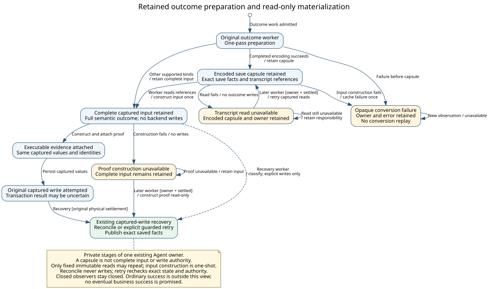

# Prepare native outcome evidence before storage writes

Agent owns the records and local delivery of one accepted execution outcome. MultiAgent owns the native child relationships that determine whether that outcome is final, waiting for coordination, or waiting for approval. Persistence owns the real transaction and authoritative readback. G3i moves complete outcome preparation ahead of the physical writes within these existing responsibilities; it adds no public API or new job owner.

For example, a report parent first waits for its reviewer, then asks permission to publish, then completes the report. A storage fault at any of those three parent saves must not repeat the review, the publication Tool, or a Provider response. Capturing the exact save proposal before writing gives the original owner enough evidence to use its existing reconciliation and explicit persistence-only retry operations.

This document compares applied G3h `cfef5fc0b961e8e29868e0fa15b03326dc1d7629` with G3i. Contract concept v55 and foundation v48 are the responsibility references. The preceding [native outcome and approval recovery account](native-parent-outcome-recovery.md) defines the public protocol; this change repairs a bounded preparation gap within it. An arbitrary encoder or conversion failure before a complete proposal remains unresolved and is not counted as a completed recovery.

## Responsibility and the capture boundary

The original native worker prepares Agent values and native values under the existing guarded transaction. It retains complete detached input, constructs the proof object, and only then applies the captured physical writes. A content-only buffer holds encoded bytes; it is neither a replacement Store nor a committed transaction.

For example, an approval-wait proposal includes the exact approval request, suspended execution and root, encoded Agent content, native extension content and permitted retention changes. If its first content write fails, the proposal is already complete. If proof construction itself fails after complete raw capture, later recovery may rebuild that proof without reconstructing the approval request.

| Owner | Preparation responsibility | Physical or publication responsibility |
| --- | --- | --- |
| Agent | Validate output once; prepare content, record identities, timestamps, journal sequences, root/execution values and semantic outcome; retain complete before/after values. | Apply captured Agent writes through Persistence; publish the confirmed saved kind on the original owner. |
| MultiAgent | Interpret native child acknowledgements, pending work, cancellation, extension content and allowed retention changes. | Supply current native authority for captured-write retry; preserve the native relationship and saved-kind meaning. |
| Persistence | Supply the guarded outer scope, identity and authoritative read views. | Atomically apply captured content, records, extension and retention effects; expose exact pre/post or conflicting state. |
| Application | Select whether a confirmed pre-state should be retried and whether a restored approval request should receive a new decision. | Observe fresh recovery results; keep unresolved responsibility alive; submit later approval or resume separately. |

The principal implementation points are `ExecutionOutcomeCommitter#prepare_terminal_outcome`, the private `ExecutionChange#commit_prepared_outcome_in`, `OutcomeWritePlan`, `TerminalPersistenceEvidence::CapturedInput`, and the native coordinator's private `commit_prepared_outcome`. The native coordinator supplies this private opt-in; existing custom participants and Handoff are not made repeatable by it.

Complete raw input contains detached proof outcome values as well as before/after footprints and captured content. Error diagnostics, approval hashes and result copying occur before that input is retained. Later `CapturedInput#materialize` uses those retained values and the original Store identity; it does not call output validation, the runtime encoder, participant commit, Provider or Tool work again. Failure while producing those complete values is still an incomplete-preparation failure.

## Unchanged public operations and distinct lifetimes

Recovery acts on an exact capability retained by the original Agent incarnation. The existing method families distinguish read-only reconciliation, explicit captured-write retry and first-submission retry. Each asynchronous call returns a fresh observation; the synchronous form waits for that observation on a host thread.

For example, `parent.reconcile_outcome(recovery: recovery)` can confirm that an approval wait was saved and publish its request. It cannot approve the request. `parent.retry_outcome(recovery: recovery)` can save a complete retained proposal only when current pre-state and native authority permit it; it cannot regenerate an incomplete proposal.

| Operation or family | Arguments and defaults | Result and sync/async symmetry | Lifetime and boundary |
| --- | --- | --- | --- |
| `pending_outcome_recovery` | Required `execution_id:`; nonempty String. | Exact `OutcomeRecovery` or `nil`; local lookup has no async partner because it performs no I/O. | Original incarnation only; resolved recovery leaves the pending index. |
| `reconcile_outcome` / `reconcile_outcome_async` | Required exact `recovery:`; no retry flag or timeout argument. | `OutcomeRecoveryResult` / fresh `TaskResult<OutcomeRecoveryResult>`. | Reads persistence and may apply a confirmed fact locally; never retries storage or business work. Pure proof reconstruction is permitted after physical settlement. |
| `retry_outcome` / `retry_outcome_async` | Required exact `recovery:`; no implicit application-policy default. | Same receipt family / fresh task. | Explicit captured-write permission only; rechecks exact pre-state and current native authority. |
| `retry_outcome_submission` / `retry_outcome_submission_async` | Required exact `recovery:`; no new preparation-retry option. | Same receipt family / fresh task. | Only positive first-submission refusal authorizes submission. An admitted preparation failure does not qualify. |
| `TerminalRecovery` | Existing terminal-only family. | Existing final-result semantics. | Native waits do not become terminal results; the native preparation opt-in does not broaden standalone preparation recovery. |
| `ApprovalRecovery` | Existing exact decision capability and reconciliation operations. | Existing decision and continuation receipts. | Read-only recovery of a decision; restoring a pre-state wait does not submit approval again. |

The synchronous recovery methods reject EventLoop reentrancy. Observation timeout and cancellation belong to `TaskResult`; they do not terminate the physical operation, transfer ownership or authorize a concurrent write. The original failed observation stays failed even after a later recovery succeeds.

| Confirmed saved kind | Meaning of recovery-owner release | Remaining job responsibility |
| --- | --- | --- |
| Terminal | The exact final result has been applied and local execution admission can end. | Durable history and explicit relationship cleanup still follow their existing contracts. |
| Coordination wait | Publication of the captured wait ends this save-recovery responsibility and its local execution admission. | The durable parent job remains active with its native child relationship; later ordinary resume is separate. |
| Approval wait | Publication of the exact request ends this save-recovery responsibility. | Suspended execution admission and cancellation binding remain live until the approval protocol advances. |

A generic preparation retry API was rejected because a frozen command or an unchanged Store does not prove arbitrary conversion or participant code is safe to run twice. A generic virtual Store was unnecessary because the required reusable input is a bounded native and Agent persistence plan. The application keeps explicit policy rather than hiding automatic retry or automatic approval in a helper.

## Equivalence and intentional failure behavior changes

Ordinary report execution preserves the same input, approval order, outputs, business effects and release behavior. Fault behavior is intentionally different only where a complete proposal can be prepared before a storage failure; this is a recovery improvement, not observational equivalence under failure.

For example, the normal report performs five offline Provider calls, one review Tool and one publication Tool. With a terminal native-content fault, G3h retains an unavailable recovery owner. G3i preserves the complete proposal, classifies exact pre-state, and permits an explicitly requested captured-write retry without a sixth Provider call or a second publication.

| Condition | Before: applied G3h | After: G3i contract |
| --- | --- | --- |
| Normal workflow | Two explicit approvals; child output `review ready`; parent output `report ready`; five Provider calls and one effect per Tool; both jobs complete and explicit unload releases the local owner pair while durable history remains. | The same ordinary application function and observable business contract. |
| Selected physical content, journal, execution or root write fails during the original save | In the characterized cases, the owner remains retained and reconciliation is unavailable because the complete proposal was not retained. | Complete raw input and proof precede the write. Reconciliation classifies exact state; explicit captured-write retry can finish from an eligible pre-state. |
| Proof wrapper fails after complete raw capture | No separate retained raw-input materialization path. | Retain complete input and responsibility; after original physical settlement, materialize the proof read-only, then reconcile or explicitly retry. No initial write is admitted without the proof. |
| Application declines captured-write retry | Retained unavailable recovery in the characterized pre-capture fault cases. | A confirmed pre-state remains retained. No Provider, Tool or persistence write is automatically repeated. |
| A recovered approval decision restores its pre-state wait | The separate approval protocol requires a new application decision. | Same requirement; `approve_after_restore: false` leaves the exact wait pending. |
| Encoder, conversion, diagnostic detachment or other preparation fails before complete input | Incomplete evidence and unresolved ownership. | Still unresolved; do not replay opaque preparation or describe a retained owner as successful cleanup. |
| Current cancellation, native child authority or durable state conflicts | Existing evidence and ownership must be preserved. | No forced captured write and no substituted relationship. Historical confirmed post-state remains a fact; new write authority is checked separately. |
| Observer closes while physical work continues | Observer completion does not establish physical settlement. | Same custody and overlap rules. |

The physical fixture below raises immediately before or after one repository call inside the original outer transaction. An after-write injection can still roll that transaction back; it is not by itself evidence of a committed post-state. Lost committed acknowledgements, conflicting readback and physical overlap require their separate implementation tests.

## Shared application setup

The report application uses the actual Runtime, native parent/child orchestration, approval APIs and in-memory Persistence. Only the Provider is deterministic and offline. The shared setup defines every business class and dependency used by both versions of the functions below.

For example, the Provider first dispatches the reviewer, later asks the parent to publish, and raises if the workflow requests any unexpected sixth response. Both Tools require independent explicit approval and record their effects so repeated business work is visible. This example declares no output schema: its zero output-validator counter is not evidence about parser replay. The independent [Runtime acceptance suite](../../spec/phronomy/multi_agent/native_outcome_preparation_recovery_spec.rb) separately supplies a real output schema, observes one validation and one encoding before a content failure, and verifies that reconciliation and captured-write retry leave those counts at one.

Copy this setup once, one selected column of each function comparison, the shared recovery helpers, the complete fixture and the shared driver into a single Ruby file in that order. The helpers may be defined after the normal function; all definitions are loaded before the driver runs. No external application helper or omitted policy is required. The fixture intentionally instruments the process, so run each example in a fresh Ruby process with the chosen Phronomy checkout on the load path.

<!-- g3i-code:shared-setup -->
```ruby
require "phronomy"
require "json"
require "timeout"
class G3iReviewTool < Phronomy::Tool::Base
  tool_name "review_one_report"
  description "Review the approved report once"
  requires_approval true

  class << self
    attr_accessor :effects
  end

  def execute(query:)
    self.class.effects << query
    "reviewed #{query}"
  end
end

class G3iPublishTool < Phronomy::Tool::Base
  tool_name "publish_one_report"
  description "Publish the approved report once"
  requires_approval true

  class << self
    attr_accessor :effects
  end

  def execute(query:)
    self.class.effects << query
    "published #{query}"
  end
end

class G3iReviewAgent < Phronomy::Agent::Base
  agent_definition id: "native-outcome-reviewer", version: 1
  model "offline-model"
  tools G3iReviewTool => nil
end

class G3iReportParent < Phronomy::MultiAgent::Orchestrator
  agent_definition id: "native-outcome-parent", version: 1
  model "offline-model"
  tools G3iPublishTool => nil
  subagent :reviewer, G3iReviewAgent
end

class G3iReportAdapter < Phronomy::LLMAdapter::Base
  attr_reader :calls

  def initialize
    @calls = 0
  end

  def perform_complete(_request, cancellation_token:)
    cancellation_token&.raise_if_cancelled!
    @calls += 1
    name, arguments = case @calls
    when 1 then ["dispatch_to_reviewer", {input: "Review the report"}]
    when 2 then ["review_one_report", {query: "quarterly report"}]
    when 3
      return Phronomy::LLMAdapter::Response.new(content: "review ready", finish_reason: :stop)
    when 4 then ["publish_one_report", {query: "quarterly report"}]
    when 5
      return Phronomy::LLMAdapter::Response.new(content: "report ready", finish_reason: :stop)
    else
      raise "Unexpected repeated Provider work"
    end
    Phronomy::LLMAdapter::Response.new(tool_calls: [
      Phronomy::Tool::CallRequest.new(id: "call-#{@calls}", name: name, arguments: arguments)
    ], finish_reason: :tool_calls)
  end
end

def build_report_service
  G3iReviewTool.effects = []
  G3iPublishTool.effects = []
  adapter = G3iReportAdapter.new
  Phronomy.configure { |configuration| configuration.llm_adapter = adapter }
  stores = Phronomy::PersistenceComposition.in_memory
  approvals = Queue.new
  parent = G3iReportParent.create(agent_id: "native-outcome-parent", persistence: stores.agent,
    coordination_store: stores.multi_agent,
    on_event: ->(event) { approvals << event.payload.fetch(:request) if event.type == :approval_required })
  [adapter, stores, approvals, parent]
end
```
<!-- /g3i-code:shared-setup -->

## Complete ordinary function before and after

The normal application function directly names each approval owner, observes the two known waiting points and explicitly unloads the completed parent/child local owner pair. Both columns are complete and identical because G3i changes preparation within the framework rather than requiring a new normal application protocol.

For example, the first request identifies the reviewer execution and is approved on that child. The second request must identify the parent execution before publication is approved. The returned values expose outputs, effects, job statuses, revisions and remaining history holds for comparison. Normal execution returns revisions `[9, 6]` and history holds `[1, 1]` in both versions; successful local unload does not erase those durable holds.

<table>
<thead><tr><th>Before: applied G3h</th><th>After: G3i</th></tr></thead>
<tbody><tr>
<td><pre><code class="language-ruby" data-g3i-unit="normal-before"># The exact approval request identifies which entity may accept the decision.
def run_report
  adapter, stores, approvals, parent = build_report_service
  parent_id = "native-report-execution"
  reservation = Phronomy::Agent::ReservedExecution.new(agent_id: parent.agent_id, execution_id: parent_id)
  original = parent.start_hosted(reservation: reservation, input: "Prepare and publish the report")
  child_request = Timeout.timeout(5) { approvals.pop }
  begin
    original.wait_result(timeout: 5)
  rescue Phronomy::ExecutionRehydrationRequiredError
    # The parent waits for this approval-driven child.
  end
  child = Phronomy::Agent::Base.live_for_execution(child_request.execution_id)
  child_result = child.approve_async(child_request.execution_id,
    approval_request_id: child_request.id, approved: true).wait_result(timeout: 5)
  continued = parent.resume_async(parent_id)
  parent_request = Timeout.timeout(5) { approvals.pop }
  raise "Expected the parent's own approval" unless parent_request.execution_id == parent_id
  begin
    continued.wait_result(timeout: 5)
  rescue Phronomy::ExecutionRehydrationRequiredError
    # The parent now waits for its own publication decision.
  end
  parent_result = parent.approve_async(parent_id,
    approval_request_id: parent_request.id, approved: true).wait_result(timeout: 5)
  released = parent.unload_with_completed_child!(parent_id, execution_id: child_request.execution_id)
  {
    child_output: child_result.fetch(:output), parent_output: parent_result.fetch(:output),
    review_effects: G3iReviewTool.effects, publication_effects: G3iPublishTool.effects,
    provider_calls: adapter.calls, released: released,
    statuses: [parent_id, child_request.execution_id].map { |id| stores.agent.executions.load(id).status },
    revisions: [parent_id, child_request.execution_id].map { |id| stores.agent.executions.load(id).execution_revision },
    history_holds: [parent.agent_id, child.agent_id].map { |id| stores.agent.retained_references(agent_id: id).size }
  }
end
</code></pre></td>
<td><pre><code class="language-ruby" data-g3i-unit="normal-after"># The exact approval request identifies which entity may accept the decision.
def run_report
  adapter, stores, approvals, parent = build_report_service
  parent_id = "native-report-execution"
  reservation = Phronomy::Agent::ReservedExecution.new(agent_id: parent.agent_id, execution_id: parent_id)
  original = parent.start_hosted(reservation: reservation, input: "Prepare and publish the report")
  child_request = Timeout.timeout(5) { approvals.pop }
  begin
    original.wait_result(timeout: 5)
  rescue Phronomy::ExecutionRehydrationRequiredError
    # The parent waits for this approval-driven child.
  end
  child = Phronomy::Agent::Base.live_for_execution(child_request.execution_id)
  child_result = child.approve_async(child_request.execution_id,
    approval_request_id: child_request.id, approved: true).wait_result(timeout: 5)
  continued = parent.resume_async(parent_id)
  parent_request = Timeout.timeout(5) { approvals.pop }
  raise "Expected the parent's own approval" unless parent_request.execution_id == parent_id
  begin
    continued.wait_result(timeout: 5)
  rescue Phronomy::ExecutionRehydrationRequiredError
    # The parent now waits for its own publication decision.
  end
  parent_result = parent.approve_async(parent_id,
    approval_request_id: parent_request.id, approved: true).wait_result(timeout: 5)
  released = parent.unload_with_completed_child!(parent_id, execution_id: child_request.execution_id)
  {
    child_output: child_result.fetch(:output), parent_output: parent_result.fetch(:output),
    review_effects: G3iReviewTool.effects, publication_effects: G3iPublishTool.effects,
    provider_calls: adapter.calls, released: released,
    statuses: [parent_id, child_request.execution_id].map { |id| stores.agent.executions.load(id).status },
    revisions: [parent_id, child_request.execution_id].map { |id| stores.agent.executions.load(id).execution_revision },
    history_holds: [parent.agent_id, child.agent_id].map { |id| stores.agent.retained_references(agent_id: id).size }
  }
end
</code></pre></td>
</tr></tbody>
</table>

## Shared explicit recovery policy

The recovery helpers separate an observed failure from application permission to retry its captured persistence. They verify the exact retained capability and never reopen the original failed task. Approval decision recovery remains a separate branch with its own explicit permission to submit a restored request again.

For example, `retry_confirmed_pre: false` returns a pending owner after a confirmed pre-state instead of repairing it automatically. If approval reconciliation restores a wait, `approve_after_restore: false` returns that wait instead of sending another approval. A production service must retain the returned parent, capability and receipt while responsibility is pending.

<!-- g3i-code:recovery-helper -->
```ruby
# This example retries only captured outcome persistence when its application
# explicitly permits that action. Wait recovery is not job completion.
def settle_parent_outcome(parent:, failure:, retry_confirmed_pre:, recoveries:)
  recovery = parent.pending_outcome_recovery(execution_id: failure.recovery.execution_id)
  raise "The exact outcome owner was not retained" unless recovery.equal?(failure.recovery)
  receipt = parent.reconcile_outcome(recovery: recovery)
  if retry_confirmed_pre && receipt.outcome == :confirmed_pre
    receipt = parent.retry_outcome(recovery: recovery)
  end
  applied = receipt.outcome == :confirmed_post && receipt.application_state == :applied && receipt.ownership_state == :released
  return {state: :recovery_pending, parent: parent, recovery: recovery, receipt: receipt} unless applied

  recoveries << {operation: :outcome, saved_outcome: receipt.saved_outcome, outcome: receipt.outcome}
  case receipt.saved_outcome
  when :coordination_wait then {state: :coordination_wait}
  when :approval_wait then {state: :approval_wait, request: receipt.approval_request}
  when :terminal
    execution = receipt.execution
    raise "Report failed: #{execution.error.inspect}" unless execution.status == :completed
    {state: :completed, result: {output: execution.result}}
  end
end

# expected_wait describes this report's two known waiting points. It is not a
# general classification of every ExecutionRehydrationRequiredError.
def await_parent_outcome(parent:, task:, expected_wait:, retry_confirmed_pre:, recoveries:)
  {state: :completed, result: task.wait_result(timeout: 5)}
rescue Phronomy::Agent::OutcomeRecoveryError => failure
  observed = settle_parent_outcome(parent: parent, failure: failure,
    retry_confirmed_pre: retry_confirmed_pre, recoveries: recoveries)
  begin
    task.wait_result(timeout: 5)
    raise "The earlier failed observation reopened"
  rescue Phronomy::Agent::OutcomeRecoveryError => repeated
    raise "The earlier failure changed" unless repeated.equal?(failure)
  end
  observed
rescue Phronomy::ExecutionRehydrationRequiredError
  {state: expected_wait}
end

# Approval recovery only reconciles the old decision. A confirmed pre-state
# restores the exact wait; sending an approval again is a separate user policy.
def approve_report(parent:, execution_id:, request:, approve_after_restore:, retry_confirmed_pre:, recoveries:)
  task = parent.approve_async(execution_id, approval_request_id: request.id, approved: true)
  begin
    await_parent_outcome(parent: parent, task: task, expected_wait: :approval_wait,
      retry_confirmed_pre: retry_confirmed_pre, recoveries: recoveries)
  rescue Phronomy::Agent::ApprovalRecoveryError => failure
    recovery = parent.pending_approval_recovery(execution_id: execution_id)
    raise "The exact approval owner was not retained" unless recovery.equal?(failure.recovery)
    receipt = parent.reconcile_approval(recovery: recovery)
    unless receipt.resolved?
      return {state: :recovery_pending, parent: parent, recovery: recovery, receipt: receipt}
    end
    begin
      task.wait_result(timeout: 5)
      raise "The earlier failed decision reopened"
    rescue Phronomy::Agent::ApprovalRecoveryError => repeated
      raise "The earlier decision failure changed" unless repeated.equal?(failure)
    end
    recoveries << {operation: :approval, outcome: receipt.outcome, continuation_state: receipt.continuation_state}
    if receipt.continuation_state == :restored
      unless approve_after_restore
        return {state: :approval_wait, parent: parent, request: request, receipt: receipt}
      end
      next_task = parent.approve_async(execution_id, approval_request_id: request.id, approved: true)
    else
      next_task = receipt.execution_task
    end
    await_parent_outcome(parent: parent, task: next_task, expected_wait: :approval_wait,
      retry_confirmed_pre: retry_confirmed_pre, recoveries: recoveries)
  end
end
```
<!-- /g3i-code:recovery-helper -->

## Complete recovery function before and after

The same complete recovery function uses only existing public operations on both versions. It preserves the same business process as the ordinary function while exposing unresolved responsibility and policy choices as explicit return values. The columns are source-identical; the storage-fault results are intentionally different under the capture-before-write implementation.

For example, a failure at the first coordination-wait save can return before the reviewer is approved. A failure at the parent's own approval wait can return after review but before publication. A final-save failure can recover the already computed report without either Tool executing twice.

<table>
<thead><tr><th>Before: applied G3h</th><th>After: G3i</th></tr></thead>
<tbody><tr>
<td><pre><code class="language-ruby" data-g3i-unit="recovery-before"># The same business process has two independent application approvals. Neither
# persistence recovery nor a recovered wait silently supplies either decision.
def run_report_with_recovery(fault:, retry_confirmed_pre: false, approve_after_restore: false)
  adapter, stores, approvals, parent = build_report_service
  parent_id = "native-report-execution"
  fault.call(stores.agent, parent_id)
  reservation = Phronomy::Agent::ReservedExecution.new(agent_id: parent.agent_id, execution_id: parent_id)
  recoveries = []
  original = parent.start_hosted(reservation: reservation, input: "Prepare and publish the report")
  first = await_parent_outcome(parent: parent, task: original, expected_wait: :coordination_wait,
    retry_confirmed_pre: retry_confirmed_pre, recoveries: recoveries)
  return first.merge(stores: stores, execution_id: parent_id, provider_calls: adapter.calls) if first.fetch(:state) == :recovery_pending
  raise "Expected the child coordination wait" unless first.fetch(:state) == :coordination_wait
  child_request = Timeout.timeout(5) { approvals.pop }
  child = Phronomy::Agent::Base.live_for_execution(child_request.execution_id)
  child_result = child.approve_async(child_request.execution_id,
    approval_request_id: child_request.id, approved: true).wait_result(timeout: 5)
  continued = parent.resume_async(parent_id)
  second = await_parent_outcome(parent: parent, task: continued, expected_wait: :approval_wait,
    retry_confirmed_pre: retry_confirmed_pre, recoveries: recoveries)
  return second.merge(stores: stores, child: child, execution_id: parent_id, provider_calls: adapter.calls) if second.fetch(:state) == :recovery_pending
  raise "Expected the parent's own approval" unless second.fetch(:state) == :approval_wait
  parent_request = second[:request] || Timeout.timeout(5) { approvals.pop }
  raise "Approval identifies another execution" unless parent_request.execution_id == parent_id
  final = approve_report(parent: parent, execution_id: parent_id, request: parent_request,
    approve_after_restore: approve_after_restore, retry_confirmed_pre: retry_confirmed_pre, recoveries: recoveries)
  unless final.fetch(:state) == :completed
    return final.merge(stores: stores, child: child, execution_id: parent_id, provider_calls: adapter.calls)
  end
  released = parent.unload_with_completed_child!(parent_id, execution_id: child_request.execution_id)
  {
    state: :observed, child_output: child_result.fetch(:output), parent_output: final.fetch(:result).fetch(:output),
    review_effects: G3iReviewTool.effects, publication_effects: G3iPublishTool.effects,
    provider_calls: adapter.calls, released: released,
    statuses: [parent_id, child_request.execution_id].map { |id| stores.agent.executions.load(id).status },
    history_holds: [parent.agent_id, child.agent_id].map { |id| stores.agent.retained_references(agent_id: id).size },
    recoveries: recoveries
  }
end
</code></pre></td>
<td><pre><code class="language-ruby" data-g3i-unit="recovery-after"># The same business process has two independent application approvals. Neither
# persistence recovery nor a recovered wait silently supplies either decision.
def run_report_with_recovery(fault:, retry_confirmed_pre: false, approve_after_restore: false)
  adapter, stores, approvals, parent = build_report_service
  parent_id = "native-report-execution"
  fault.call(stores.agent, parent_id)
  reservation = Phronomy::Agent::ReservedExecution.new(agent_id: parent.agent_id, execution_id: parent_id)
  recoveries = []
  original = parent.start_hosted(reservation: reservation, input: "Prepare and publish the report")
  first = await_parent_outcome(parent: parent, task: original, expected_wait: :coordination_wait,
    retry_confirmed_pre: retry_confirmed_pre, recoveries: recoveries)
  return first.merge(stores: stores, execution_id: parent_id, provider_calls: adapter.calls) if first.fetch(:state) == :recovery_pending
  raise "Expected the child coordination wait" unless first.fetch(:state) == :coordination_wait
  child_request = Timeout.timeout(5) { approvals.pop }
  child = Phronomy::Agent::Base.live_for_execution(child_request.execution_id)
  child_result = child.approve_async(child_request.execution_id,
    approval_request_id: child_request.id, approved: true).wait_result(timeout: 5)
  continued = parent.resume_async(parent_id)
  second = await_parent_outcome(parent: parent, task: continued, expected_wait: :approval_wait,
    retry_confirmed_pre: retry_confirmed_pre, recoveries: recoveries)
  return second.merge(stores: stores, child: child, execution_id: parent_id, provider_calls: adapter.calls) if second.fetch(:state) == :recovery_pending
  raise "Expected the parent's own approval" unless second.fetch(:state) == :approval_wait
  parent_request = second[:request] || Timeout.timeout(5) { approvals.pop }
  raise "Approval identifies another execution" unless parent_request.execution_id == parent_id
  final = approve_report(parent: parent, execution_id: parent_id, request: parent_request,
    approve_after_restore: approve_after_restore, retry_confirmed_pre: retry_confirmed_pre, recoveries: recoveries)
  unless final.fetch(:state) == :completed
    return final.merge(stores: stores, child: child, execution_id: parent_id, provider_calls: adapter.calls)
  end
  released = parent.unload_with_completed_child!(parent_id, execution_id: child_request.execution_id)
  {
    state: :observed, child_output: child_result.fetch(:output), parent_output: final.fetch(:result).fetch(:output),
    review_effects: G3iReviewTool.effects, publication_effects: G3iPublishTool.effects,
    provider_calls: adapter.calls, released: released,
    statuses: [parent_id, child_request.execution_id].map { |id| stores.agent.executions.load(id).status },
    history_holds: [parent.agent_id, child.agent_id].map { |id| stores.agent.retained_references(agent_id: id).size },
    recoveries: recoveries
  }
end
</code></pre></td>
</tr></tbody>
</table>

## Complete physical fault fixture

The fixture wraps actual committer and repository methods to select one parent outcome and one physical write. It counts committer, encoder, legacy participant-commit and output-validation calls across both the original worker and recovery worker. It does not replace Persistence or replay application work.

For example, `parent_storage_fault(boundary: :approval_wait, site: :agent_content, mode: :after)` injects exactly one failure after the parent's Agent content call. Native content and execution writes apply to all three outcomes; Agent content and root writes apply to terminal and approval-wait saves; a terminal journal write applies only to a terminal save. These eleven sites each have before/after variants, giving twenty-two fault cases. The G3i private native preparation path bypasses the legacy participant `commit` method, so its zero participant-commit count does not mean no native preparation occurred; direct private-preparation call counts belong to the independent Runtime acceptance tests.

<!-- g3i-code:fault-fixture -->
```ruby
# The fault fixture observes the real committer and physical repositories.
# It does not substitute a persistence implementation or replay application work.
module G3iOutcomeInstrumentation
  class << self
    attr_accessor :fault

    def selected?(command)
      return false unless fault && command.execution_id == fault.fetch(:execution_id)

      view = command.terminal_view
      error = view.callback_failure&.to_stream_callback_error || view.source_error ||
        view.block_error || view.invocation_error
      case fault.fetch(:boundary)
      when :coordination_wait then error.is_a?(Phronomy::ExecutionRehydrationRequiredError)
      when :approval_wait then !error && view.phase == :suspended
      when :terminal then !error && !view.rejected && !view.handoff && view.phase != :suspended
      else false
      end
    end

    def context = Thread.current[:g3i_outcome_fault]

    def count(key)
      current = context
      current[key] += 1 if current
    end

    def around_write(site)
      current = context
      return yield unless current && current[:armed] && current.fetch(:site) == site

      current[:armed] = false
      current[:hits] += 1
      current[:hit_site] = site
      raise IOError, "Injected physical #{site} failure before write" if current.fetch(:mode) == :before

      value = yield
      raise IOError, "Injected physical #{site} failure after write" if current.fetch(:mode) == :after

      value
    end

    def report
      return {enabled: false} unless fault

      fault.reject { |key, _| %i[execution_id armed].include?(key) }
    end
  end
end

module G3iOutcomeFaultScope
  def commit_outcome(command, **options)
    previous = Thread.current[:g3i_outcome_fault]
    current = G3iOutcomeInstrumentation.selected?(command) ? G3iOutcomeInstrumentation.fault : nil
    Thread.current[:g3i_outcome_fault] = current
    G3iOutcomeInstrumentation.count(:committer_calls)
    super
  ensure
    Thread.current[:g3i_outcome_fault] = previous
  end
end

module G3iPhysicalContentFault
  def put(bytes, **options)
    current = G3iOutcomeInstrumentation.context
    return super unless current

    value = begin
      JSON.parse(bytes)
    rescue JSON::ParserError
      nil
    end
    site = value.is_a?(Hash) && value.key?("children") && value.key?("cancel_requested") ? :native_content : :agent_content
    G3iOutcomeInstrumentation.around_write(site) { super }
  end
end

module G3iRecoveryWorkScope
  private

  def submit_recovery_worker(id, &work)
    current = G3iOutcomeInstrumentation.fault
    selected = current && current.fetch(:execution_id) == execution_id
    super(id) do
      previous = Thread.current[:g3i_outcome_fault]
      Thread.current[:g3i_outcome_fault] = selected ? current : nil
      begin
        work.call
      ensure
        Thread.current[:g3i_outcome_fault] = previous
      end
    end
  end
end

module G3iPhysicalJournalFault
  def append(*args, **options)
    G3iOutcomeInstrumentation.around_write(:journal) { super }
  end
end

module G3iPhysicalExecutionFault
  def save(*args, **options)
    G3iOutcomeInstrumentation.around_write(:execution) { super }
  end
end

module G3iPhysicalRootFault
  def save(*args, **options)
    G3iOutcomeInstrumentation.around_write(:root) { super }
  end
end

module G3iEncoderCounter
  def encode(*args, **options)
    G3iOutcomeInstrumentation.count(:encoder_calls)
    super
  end
end

module G3iParticipantCounter
  def commit(*args, **options)
    G3iOutcomeInstrumentation.count(:participant_calls)
    super
  end
end

module G3iOutputValidationCounter
  def validate(*args, **options)
    G3iOutcomeInstrumentation.count(:output_validation_calls)
    super
  end
end

Phronomy::Agent::ExecutionOutcomeCommitter.prepend(G3iOutcomeFaultScope)
Phronomy::Agent::OutcomeRecoveryOperation.prepend(G3iRecoveryWorkScope)
Phronomy::ContentStore::StoredContents.prepend(G3iPhysicalContentFault)
Phronomy::Agent::Persistence::JournalRepository.prepend(G3iPhysicalJournalFault)
Phronomy::Agent::Persistence::ExecutionRepository.prepend(G3iPhysicalExecutionFault)
Phronomy::Agent::Persistence::AgentRepository.prepend(G3iPhysicalRootFault)
Phronomy::Agent::RuntimeRecordEncoder.singleton_class.prepend(G3iEncoderCounter)
Phronomy::MultiAgent::DurableSubagentCoordinator.prepend(G3iParticipantCounter)
Phronomy::Agent::OutputContract.prepend(G3iOutputValidationCounter)

def parent_storage_fault(boundary:, site:, mode:)
  raise ArgumentError, "Unsupported outcome boundary" unless %i[terminal coordination_wait approval_wait].include?(boundary)
  raise ArgumentError, "Unsupported physical write" unless %i[native_content agent_content journal execution root].include?(site)
  raise ArgumentError, "Unsupported write failure" unless %i[before after].include?(mode)

  lambda do |_store, execution_id|
    G3iOutcomeInstrumentation.fault = {
      boundary: boundary, site: site, mode: mode, execution_id: execution_id,
      armed: true, hits: 0, committer_calls: 0, encoder_calls: 0,
      participant_calls: 0, output_validation_calls: 0
    }
  end
end

```
<!-- /g3i-code:fault-fixture -->

## Shared driver and visible cleanup

The driver chooses the normal or fault scenario, reports durable status and retained responsibility, and executes the same explicit Runtime cleanup in both versions. It is a one-shot demonstration, not a process-loss recovery service. A cleanup failure is reported rather than treated as successful release.

For example, with retries disabled a recovered pre-state remains pending and can prevent complete shutdown cleanup. An actual service must keep the returned capability and original owner alive; ending this demonstration process does not establish that the unfinished job was safely transferred or recovered.

<!-- g3i-code:shared-driver -->
```ruby
# A running service keeps the returned parent, capability and receipt when
# recovery is pending. This one-shot demonstration reports that state and its
# cleanup result before the process ends; it is not a crash recovery service.
def run_report_example(scenario:, boundary: :terminal, site: :native_content, mode: :before,
  retry_confirmed_pre: false, approve_after_restore: false)
  raise ArgumentError, "Unknown report scenario" unless %i[normal recovery].include?(scenario)
  begin
    value = if scenario == :normal
      run_report
    else
      run_report_with_recovery(fault: parent_storage_fault(boundary: boundary, site: site, mode: mode),
        retry_confirmed_pre: retry_confirmed_pre, approve_after_restore: approve_after_restore)
    end
    if %i[recovery_pending approval_wait].include?(value[:state])
      receipt = value.fetch(:receipt)
      report = {state: value.fetch(:state), outcome: receipt.outcome,
                application_state: receipt.application_state,
                saved_outcome: (receipt.saved_outcome if receipt.respond_to?(:saved_outcome)),
                ownership_state: (receipt.ownership_state if receipt.respond_to?(:ownership_state)),
                continuation_state: (receipt.continuation_state if receipt.respond_to?(:continuation_state)),
                provider_calls: value.fetch(:provider_calls),
                durable_status: value.fetch(:stores).agent.executions.load(value.fetch(:execution_id)).status,
                review_effects: G3iReviewTool.effects.dup, publication_effects: G3iPublishTool.effects.dup}
    else
      report = value
    end
  ensure
    Phronomy::Runtime.instance.shutdown(timeout: 0.03, cancel_grace: 0.2)
    begin
      Phronomy.reset_runtime!
      cleanup_incomplete = false
    rescue Phronomy::RuntimeShutdownError
      cleanup_incomplete = true
    end
  end
  report.merge(cleanup_incomplete: cleanup_incomplete, fault: G3iOutcomeInstrumentation.report)
end

if $PROGRAM_NAME == __FILE__
  puts JSON.pretty_generate(run_report_example(
    scenario: ENV.fetch("G3I_SCENARIO", "normal").to_sym,
    boundary: ENV.fetch("G3I_BOUNDARY", "terminal").to_sym,
    site: ENV.fetch("G3I_SITE", "native_content").to_sym,
    mode: ENV.fetch("G3I_MODE", "before").to_sym,
    retry_confirmed_pre: ENV["G3I_RETRY_CAPTURED_OUTCOME"] == "true",
    approve_after_restore: ENV["G3I_APPROVE_RESTORED_WAIT"] == "true"
  ))
end
```
<!-- /g3i-code:shared-driver -->

Save the assembled file as `native_outcome_report.rb` and execute it from the selected checkout:

```sh
bundle exec ruby -Ilib /absolute/path/native_outcome_report.rb
G3I_SCENARIO=recovery G3I_BOUNDARY=terminal G3I_SITE=native_content G3I_MODE=before \
  G3I_RETRY_CAPTURED_OUTCOME=true G3I_APPROVE_RESTORED_WAIT=true \
  bundle exec ruby -Ilib /absolute/path/native_outcome_report.rb
G3I_SCENARIO=recovery G3I_BOUNDARY=approval_wait G3I_SITE=agent_content G3I_MODE=before \
  bundle exec ruby -Ilib /absolute/path/native_outcome_report.rb
```

The two environment policy switches default to false. The second command explicitly permits both captured-write retry and a new approval after restoration. The third command permits neither; pending responsibility is an intended observable result, not a completed report.

## State model and model-checking boundary

The preparation prefix extends the existing native parent outcome/approval recovery model. It changes how complete evidence becomes available before the existing recovery protocol begins. It does not merge the parent, child and client-observer state machines into one execution state.

For example, proof construction may fail while complete raw input survives and no write has begun. After the original worker physically settles, read-only materialization can restore the evidence needed to classify pre-state. If the encoder failed before complete capture, the prefix instead retains an opaque failure with no generic replay transition.



The [model README](../../spec/models/native_parent_outcome_recovery/README.md) gives the independent parent outcome, parent approval decision, child and observer views and the implementation mapping. The prefix checks complete capture before write, retained identity, read-only and physically settled materialization, opaque-preparation non-replay, ownership and conditional progress.

| Checked family | Configurations | Required outcome |
| --- | ---: | --- |
| Safety and conditional progress properties | 66 | Selected properties hold under stated bounds and premises. |
| Deliberate safety mutations | 48 | The named safety violation is detected. |
| Deliberate progress mutations | 2 | The expected temporal counterexample is detected. |
| Missing-premise cases | 10 | The specified safety or temporal counterexample is detected. |
| Reachability witnesses | 13 | The intended state is reachable, detected by the negated witness invariant. |
| Total | 139 | Every result matches its declared expectation. |

All 139 configurations passed their declared expectations. The original 99 scenarios, properties and legacy defaults were preserved; 40 configurations add 21 property checks, ten mutations, four missing-premise cases and five witnesses. These are configuration counts, not coverage percentages or independent proofs of the Ruby implementation. This remains one model family.

The finite bounds are one parent operation, one representative child relationship, three management attempts, two observers and one relevant external change. Atomic authoritative storage, existing-root guards, original-owner availability and physical settlement remain explicit premises. Conditional progress additionally requires complete preparation, readable storage, an eligible caller, explicit retry where needed, publication/cleanup availability and materializable proof. There is no promise of progress from arbitrary incomplete preparation, future approval, child completion or later parent resume.

## Validation evidence and remaining obligations

Application evidence, finite protocol checks and implementation regression tests answer different questions. The complete before/after source permits ordinary workflow equivalence and intentional failure changes to be checked separately. Source-file hashes identify the tested implementation; a baseline HEAD value alone cannot identify an uncommitted candidate.

For example, the baseline matrix reproduces unavailable recovery for twenty-two selected storage faults. The candidate recovers those same twenty-two faults with the original business outputs and effect counts, and separately preserves three pending states when application policy declines retry. The application has no output schema, so its zero validator count does not replace schema-bearing implementation tests.

| Evidence | Verified result | Limit |
| --- | --- | --- |
| Applied G3h application matrix | 23 of 23 expected results: one normal plus twenty-two selected physical-write faults. | Characterization of the selected fault sites, not all methods or all Stores. |
| Candidate application matrix | 26 of 26 expected results: identical normal report, twenty-two physical-write recoveries and three explicit-policy holds. | Actual Runtime and in-memory transaction behavior with an offline Provider; no production backend or live LLM. |
| Source provenance | All 406 baseline library Ruby files match their exact Git blobs. All 407 candidate library Ruby files match the recorded candidate digests; all per-case maps agree. | The tested candidate is identified by these digests, not by the unchanged baseline HEAD. |
| Complete example source | Eight complete units match the application source; both before/after columns are identical and both assembled files pass Ruby syntax checks. | Executable example coverage remains distinct from private preparation and backend acceptance. |
| Combined focused implementation regression | 73 examples, zero failures and zero pending, including the fourteen Runtime examples below. | Terminal evidence, native parent outcome/dispatch recovery, custody, write-plan and actual-Runtime coverage. |
| Independent actual-Runtime acceptance | 14 examples, zero failures; included in the combined total above. | Includes real output-schema validation once, physical overlap, a cancelled coalesced observer, proof/readback failure, conflicting state, retention ordering and revoked child custody; uses in-memory Persistence. |
| Hosted child integration | 15 examples, zero failures. | Native hosted-child lifecycle and outcome-recovery compatibility. |
| Native outcome model | 139 of 139 expected results, including deliberate negative cases. | Bounded protocol abstraction, not a refinement proof of Ruby or a backend conformance certificate. |
| Complete-document English check | One file scanned, zero findings and zero errors. | Language validation is separate from behavioral acceptance. |

Repository-wide regression, final source manifests and Contract dependency comparison are recorded with the delivery acceptance evidence. This document does not infer those results from the focused suites or the finite model.

The complete-input boundary leaves a real residual in completion group 1: arbitrary encoder, conversion, diagnostic or input-materialization failure before complete capture still has no supported general non-replaying resolution or termination path. Holding that owner safely is not equivalent to resolving it. A later change must either define such a resolution policy or justify a narrower repeatable preparation contract and test it.

Handoff routing, arbitrary custom participants, stopped-Runtime recovery, process-loss takeover and an absent-child distributed fence remain outside this increment. Native staging does not prove external Store atomicity or make unchanged storage a license to repeat user code. No additional public preparation method, approval decision retry, business retry or hidden automatic cleanup is introduced.
