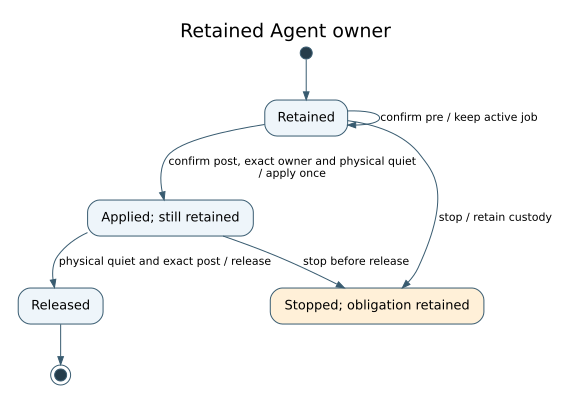
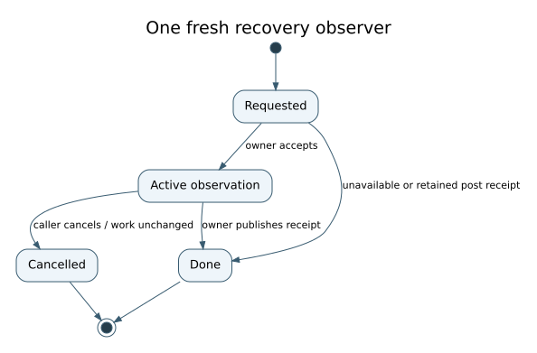

# Agent terminal recovery ownership model

This bounded TLA+ model separates the retained Agent owner from its callers and
from delivery of worker notifications. It checks the lifecycle around an already
captured terminal proposal: confirming persistence, applying the result to the
original live Agent, and releasing that Agent's admission are distinct facts.
The adjacent `agent_terminal_persistence` model checks complete record and content
comparison and exact save-only replay; this model does not duplicate those records.

For example, a research Agent has calculated an answer, but its terminal save
response and first readback are unavailable. Its original invocation ends with a
recovery error. A new observation can confirm the saved answer and ask the same
owner to apply it. If the save did not commit, the accepted job remains active;
an explicit retry saves the captured answer without running the provider again.

## Scope and starting boundary

The initial state represents a retained process-local proof whose original
caller has already received a recovery error. The Agent's admission and recovery
custody are still held. The model then explores later independent observations,
one physical read or retry lane, exact-owner application, and shutdown. It does
not model initial proposal construction, arbitrary output decoding, public Ruby
exception classes, or the preceding transfer of responsibility into this owner.

For example, the `pending` profile starts after logical failure while the original
physical save may still be running and the backend may not have settled. Those
two facts can change in either order. A local worker returning is insufficient to
establish the backend's final state.

The implementation baseline is G3b-1 commit
`e4a57fa278ed5136679ad884a8a4c51fa585382e`. The ownership protocol remains within
Agent execution responsibilities, using the existing execution environment and
persistence contracts. The current shared Contract diagrams are concept v55 and
foundation v48; their acyclicity does not imply acyclicity of all Ruby dependencies.
This finite abstraction is not a Ruby refinement proof or an external database
acceptance test.

## Separate owner and caller state machines

The owner retains the accepted job until a confirmed post-state has been applied
once, physical work is quiescent, and the captured ownership identity still
matches. A confirmed pre-state describes an active accepted job and therefore
keeps custody and admission. Stopping the Runtime cannot convert that obligation
into successful completion.

For example, confirming rollback leaves the owner in `Retained`. A later explicit
retry can write the captured post-state. If shutdown stops the owner first, the
same capability reports unavailable while the obligation remains retained.



The new callers have their own lifetimes. Their cancellation or timeout ends only
the observation; it does not cancel the owner or its physical persistence work.
The original caller is already terminal at this model's initial boundary and is
never reopened. Its stream/event callback is not invoked by a later recovery.
Normal initial completion callbacks occur before this model's starting boundary.
Each new observation can return an independent receipt.

For example, callers A and B can join one read. Cancelling A leaves the read and B
active. If B receives a confirmed post-state after application, A remains
cancelled. A same-mode join shares physical work, not a mutable returned view.



The diagrams are explanatory views. The executable model uses three separate
variables: `server`, `clients`, and `wire`. `server` includes persistence facts,
physical work, application, custody and Runtime state. `clients` includes the
original terminal observation and two later callers. `wire` represents a Ready
notification independently of the retained worker mailbox.


The precise diagrams use UML state-machine notation (states, transition labels,
initial pseudostates and final states). Their Graphviz DOT sources are included;
Graphviz is needed only to regenerate the SVGs, not to run TLC.

```sh
dot -Tsvg spec/models/agent_terminal_recovery/owner-state.dot \
  -o spec/models/agent_terminal_recovery/owner-state.svg
dot -Tsvg spec/models/agent_terminal_recovery/client-state.dot \
  -o spec/models/agent_terminal_recovery/client-state.svg
```

## Physical work and persistence assumptions

The owner admits at most one physical persistence operation, including the
original save. Read and retry are different modes: concurrent same-mode callers
join a lane, while a mixed-mode caller receives unavailable without promoting a
read into a write. A retry compares the current complete pre-state atomically
before writing; an earlier pre-state receipt is not a permanent authorization.

For example, after a read confirms pre-state, another actor may change the
cancellation record. The next retry must see conflict and write nothing. Caching
the old pre-state would overwrite that change; a mutation case detects this.

Backend settlement and authoritative reads ordered after that settlement are
explicit environmental premises of factual classification. `settled` and
`authoritative` are abstract assumptions, not claims that G3b-2 adds a Runtime
capability which can establish them. Guard exclusion, transaction atomicity and
complete proof comparison are supplied by the adjacent persistence model and the
backend contract. Local task completion, revisions and CAS alone do not establish
those premises. `Start` admits a classifying operation under those premises; the
`local_return_is_settlement` mutation deliberately violates the settlement premise.

Logical cancellation does not remove the physical slot. A lost Ready notification
can settle current observers as unavailable while leaving the mailbox and custody
intact. A later explicit observation can inspect the completed mailbox. There is
no unconditional promise of a future caller or automatic repair after every lost
notification.

## Checked properties and counterexamples

Safety checks constrain what the owner may report and release under all enabled
finite interleavings. Temporal checks add explicit conditions under which progress
is required. Mutation checks deliberately remove a rule and must produce the named
counterexample; witness checks negate a desired reachable state and must also
produce a named counterexample.

For example, `bug-release-pre` intentionally copies Workflow's inappropriate
release-on-pre policy into the Agent protocol. TLC must violate
`PreKeepsOwnership`. That expected violation is evidence that the test detects the
mistake, not a remaining violation in the adopted `Bug = "none"` protocol.

| Property | Obligation |
| --- | --- |
| `PhysicalSerialization` | At most one physical persistence operation is outstanding. |
| `PhysicalCustody` | Outstanding physical work retains custody and its physical slot. |
| `OriginalNeverReopened` | A later recovery result does not rewrite the original terminal observation. |
| `PreKeepsOwnership` | Confirmed pre-state keeps the Agent's active job and admission. |
| `ReleaseRequiresAppliedPost` | Release requires post confirmation, exactly one application and physical quiescence. |
| `ApplyOnce` | Live journal/application happen at most once. |
| `ClosedObserverNoCallback` | A later recovery cannot replay the closed original caller's stream/event callback. |
| `ExactOwnerApplication` | Stale ownership identity cannot apply a confirmed result. |
| `NoBusinessReplay` | Save-only retry never reruns the provider, Tool, parser or encoder abstraction. |
| `ReadNeverWrites` | A reconciliation read is never silently promoted into retry. |
| `NoConflictOverwrite` | An earlier pre-state result cannot authorize a later conflicting write. |
| `BackendFactsNeedSettlement` | Local return alone cannot justify a pre/post fact. |
| `CustodyUntilRelease` | Shutdown and notification failures cannot discard an unresolved obligation. |
| `ShutdownTruthful` | A clean shutdown requires released ownership and no physical work. |

The finite scope contains two later observations, one original physical save,
three abstract durable states (`pre`, `post`, `conflict`), one possible external
interference, one read outage/recovery, one identity change and one lost Ready
notification. Each observer makes one request. Successful retry can commit the
captured post-state at most once. Returned Ruby object aliasing, exact exception
identity, normal initial callback behavior, other registered non-persistence work,
arbitrary backend implementations and unbounded
process crashes require independent implementation tests.

The three progress cases require a live original owner, matching identity,
authoritative reads, no interference, no observer cancellation, no notification
loss, a deliberate required request and weak fairness of the owner/worker actions.
The pending-backend progress case additionally requires backend settlement and a
fresh caller request *after* original physical completion and backend settlement.
A finite number of premature observations is not a promise to retry forever.
The `missing-backend-settlement` case removes settlement fairness and must violate
`EventuallyReleased`; the other fairness assumptions cannot replace it.

## Implementation correspondence

The model names protocol facts rather than Ruby object layouts. The original
owner stores physical task handles and detached proof, while the Agent registry
retains the live execution and admission. Matching these responsibilities helps
review the implementation, but it does not establish step-by-step refinement.

For example, `ReleasePost` corresponds to the registry's atomic removal of the
retained operation, live execution and admission after `release_permitted?` and
registered physical-work checks. A Boolean identity in this model represents the
implementation's exact Agent/coordinator/session/revision/custody checks, including
validation of the applied local post-state before a release-only retry.

| Model concept | Implementation responsibility |
| --- | --- |
| `server` and one recovery lane | `TerminalRecoveryOperation` retains the original physical slot and at most one explicit reconciliation/retry slot. |
| `CaptureWorker` | The operation retains worker evidence independently of logical TaskResult completion. |
| `ApplyPost` | `ExecutionCoordinator#apply_retained_terminal_on_event_loop` checks exact live state and applies once on the captured EventLoop. |
| `ReleasePost` | `ExecutionRegistry#release_terminal_operation` checks physical/deferred work and atomically releases custody and admission. |
| Original closed observation | `TerminalRecoveryOperation#fail_original` settles only that observation; recovery does not reopen it or replay its callback. |
| New `clients` | Each explicit call receives its own TaskResult and immutable receipt. |
| `wire` | Ready delivery can fail while the physical slot and mailbox remain retained. |
| Stopped retained owner | `ExecutionRegistry#shutdown` preserves retained obligations; `idle?` remains false while any is retained. |
| `settled` and `authoritative` | Backend/environmental premises; no new Runtime capability gate is claimed. |

## Reproduce the checks

The runner copies the exact model and each configuration into an output directory
outside the model tree, runs TLC, and compares the result with `cases.json`. It
records tool and source hashes, commands, state counts and full logs. The runner
returns success only when every selected case matches its declared expectation.

For example, run all 27 configurations with Java 21 and the verified TLA+ tools
1.7.4 JAR. The repository does not vendor that third-party binary. Set the paths
to an existing JAR and a scratch output directory in your environment.

```sh
python3 spec/models/agent_terminal_recovery/run_checks.py \
  --jar /absolute/path/to/tla2tools-1.7.4.jar \
  --output /absolute/path/to/agent-terminal-recovery-results
```

The expected JAR SHA-256 is
`936a262061c914694dfd669a543be24573c45d5aa0ff20a8b96b23d01e050e88`.
TLA+ tools 1.7.4 prints TLC version 2.19. Select individual cases with repeated
`--case NAME` options. The selected output's `summary.json` is authoritative for
measured state counts; counts from different configurations overlap and must not
be added as a count of unique states.
