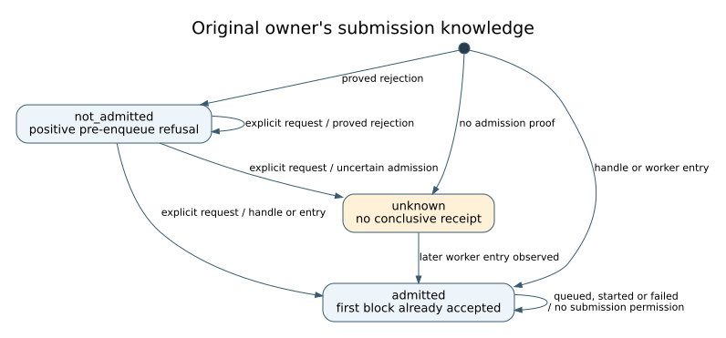
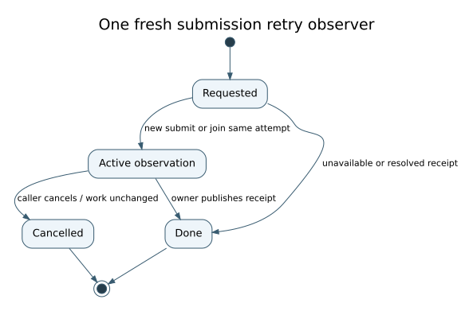

# Agent terminal submission retry model

This bounded TLA+ model checks when a retained Agent owner may submit its first
terminal worker again. Submission knowledge is separate from whether the worker
has started. The accepted job, original closed caller, later observers, actual
pool admission and captured persistence proof remain separate facts.

For example, a research Agent has already obtained its answer, but the pool
rejects the terminal worker before enqueueing it. A positive rejection receipt
can authorize one later explicit submission. That accepted worker performs the
first validation and encoding. A queued worker that has not started, or a worker
that started and failed before producing complete proof, cannot be submitted
again merely because no terminal record is visible.

## Scope and initial boundary

The model starts after the original invocation's observation has closed with a
recovery error while the original Agent retains custody and admission. It focuses
on the permission to submit the first terminal block and the boundary between
that block and an already encoded persistence retry. It does not re-prove the full
Agent lifecycle, complete durable record comparison or arbitrary Ruby behavior.

For example, the `queued` profile contains an accepted terminal task with zero
worker entries. The `unknown` profile contains an actually queued task whose
submitter raised without returning a handle or a rejection receipt. The owner
cannot safely distinguish that second situation from other uncertain admission
outcomes using the exception class alone.

The baseline is G3b-2 commit
`b88eeb55cb1d9a888cc65ac1cdb75d2b1d8398a5`. The adjacent models cover:

| Model | Responsibility |
| --- | --- |
| `agent_terminal_persistence` | Complete pre/post proof, content replay and atomic save-only retry. |
| `agent_terminal_recovery` | Original-owner application, independent observations, physical quiescence, custody and shutdown. |
| `agent_terminal_submission` | Positive non-admission evidence and at most one first terminal block. |

These scopes are complementary abstractions, not a mechanically proved
composition or a Ruby refinement proof. The shared Contract diagrams remain
concept v55 and foundation v48; source-level direction and responsibility checks
are separate from TLC.

## Submission knowledge and actual admission

The original owner recognizes three knowledge states. `not_admitted` requires a
positive receipt for the particular submission attempt before any enqueue;
`admitted` follows a returned task handle or worker entry; `unknown` means neither
conclusion is established. Acceptance consumes the submission permission before
execution starts, and a later failure cannot restore it.

For example, an earlier `on_rejected` receipt must not survive a later accepted
submission as permission for another try. The accepted task may subsequently fail
inside validation, but that does not undo admission or make validation safe to
repeat. The owner records new evidence for each attempt rather than treating an
old rejection flag as permanent authority.



| Fact | Public `submission_state` | Explicit submission retry |
| --- | --- | --- |
| Positive pre-enqueue rejection receipt, no returned handle and no worker entry | `not_admitted` | May attempt a new submission through the original live owner. |
| Task handle returned, even while still queued | `admitted` | Denied; the accepted task already owns the first block. |
| Worker entered before a submitter exception | `admitted` | Denied, including failure before complete proof. |
| No handle, no entry and no positive refusal evidence | `unknown` | Denied; error class and `started == false` do not prove rejection. |
| Complete proof retained after an admitted worker | `admitted` | Use an explicit existing reconciliation or byte-only retry call. |

The model has separate `owner`, `clients`, `pool` and `wire` variables. `pool`
records actual accepted, queued and entered blocks; `owner` records the evidence
available to the retained Agent. This separation is why the `unknown` profile can
contain queued work while the owner still reports uncertainty.

## Independent observations and retry modes

Each new observer has its own terminal outcome. Cancelling an observation leaves
the submission and its physical slot owned by the Agent. Only observers of the
same active explicit submission attempt may join it; a request against the
original already accepted initial save does not join or restart that save. Mixed
submission, reconciliation and persistence-retry requests never change mode
implicitly.

For example, callers A and B can observe one explicit submission retry. Cancelling
A does not remove the queued task, so B can still receive a result. If B instead
requests a persistence retry while the submission is active, it receives an
unavailable observation and does not convert the running submission into another
kind of operation.



The original caller is already closed at this model's initial boundary. Later
recovery does not reopen it and does not call its old stream/event callback.
Normal initial callbacks are outside this model. A complete proof permits only
the separate byte-only retry path: the public submission method does not
silently route itself into that path. Repeated calls after resolution may receive
the retained receipt without submitting or encoding again.

The state diagrams use UML state-machine notation. The knowledge diagram is a
view of admission evidence, not the entire job state machine. It intentionally
has no terminal node: admission remains an historical fact even after the job
is eventually resolved. DOT sources are included so both exact SVGs can be
regenerated with Graphviz.

## Backend contract and progress premises

The submission mechanism must emit its positive rejection receipt only before
accepting the operation and must never enqueue or execute that rejected attempt
later. The owner cannot locally prove this promise for an arbitrary custom
backend. Missing receipt support is conservative uncertainty; an exception with
a familiar class is not a substitute for the promise.

For example, a custom backend may enqueue a task and then raise the same
`BackpressureError` used for a normal pool rejection. Without a truthful
pre-enqueue rejection receipt, the owner reports `unknown` and refuses another
submission. A deliberately nonconforming model emits a refusal receipt and still
enqueues work; TLC rejects the resulting false non-admission claim.

The model assumes the adjacent persistence protocol's guard, atomicity, complete
proof, backend settlement and authoritative read conditions when entering its
abstract byte-only retry. It does not derive those conditions from worker return.
Its three positive progress configurations require the original live matching
owner, a fresh explicit caller after pool availability, successful enabled
validation/encoding/save actions, no cancellation or notification loss, and weak
fairness of the relevant pool/owner actions. Pool restoration is an explicit
condition, not something a runtime can guarantee indefinitely.

The `missing-fresh-caller` configuration removes that caller premise. Both bounded
observers may exhaust their requests while the pool is unavailable; later pool
availability then does not imply eventual submission. There is no automatic
retry loop or guarantee that a future caller will appear.

## Safety checks and expected counterexamples

Safety checks constrain the adopted protocol under bounded interleavings.
Mutation cases deliberately change one rule and must violate a named invariant.
Reachability witnesses negate a desired reachable condition and must find its
counterexample. Missing-assumption cases expose a condition on which a guarantee
depends rather than an unresolved defect in the adopted protocol.

For example, the `started_false_is_rejected` mutation submits a second block while
the first accepted task is still queued. TLC detects two accepted blocks before
either one needs to execute. The `reencode_byte_retry` mutation instead repeats
encoding on a complete-proof retry, violating its one-time encoding bound.

| Property | Obligation |
| --- | --- |
| `NonAdmissionNeedsProof` | A non-admission claim requires truthful positive refusal evidence and no accepted block. |
| `RepeatNeedsProvenRefusal` | A new submission uses the still-current positive refusal permission. |
| `AtMostOneAcceptedBlock` | At most one first terminal block is accepted. |
| `FirstBlockAtMostOnce` | At most one first terminal block enters execution. |
| `ValidationAtMostOnce` | First terminal validation is not repeated. |
| `EncodingAtMostOnce` | First terminal encoding is not repeated, including during byte-only retry. |
| `PhysicalSerialization` | The original/submission block and an evidence operation never overlap physically. |
| `PhysicalSlotPreserved` | Cancelling a caller cannot discard a known accepted task's physical slot. |
| `NoOldObserverReplay` | The original caller remains closed and its callback is not replayed. |
| `NoBusinessReplay` | Provider and Tool work are not restarted by this protocol. |
| `ReleaseSafe` | Release requires applied post-state and known physical quiescence. |
| `CustodyUntilRelease` | Unresolved obligations retain Agent custody and admission. |
| `CleanMeansResolved` | A clean shutdown cannot hide an unresolved obligation. |

The finite scope has two later observers, at most one valid accepted first block,
three admission knowledge states, one possible pool restoration, one lost Ready
notification and one identity change. The mutant state space allows additional
blocks so duplication is observable. The worker stages separate entry,
validation, encoding, proof capture, return and physical completion. Failed first
execution before proof and complete proof after rollback are distinct states.
The model abstracts away returned-object aliasing, application-specific validators,
exact exception identity, external database failures and process replacement.

## Implementation correspondence

The model's evidence transitions correspond to specific responsibilities in the
submission mechanism and retained Agent owner. The pool supplies non-admission
facts; the owner consumes them per attempt and preserves accepted custody;
ordinary reconciliation and encoded persistence retry remain separate operations.

For example, resetting a per-attempt slot to unknown before calling the submitter
prevents a previous rejected attempt from authorizing a second submission after
one later attempt was accepted. The model's `AcceptSubmission` invalidates old
refusal evidence at exactly that boundary.

| Model action or field | Implementation responsibility |
| --- | --- |
| `RejectWithProof` | Submission mechanism calls `on_rejected` before enqueue; the owner retains that attempt's proof. |
| `AcceptSubmission` / `BeginWorker` | Returned handle or worker entry makes `submission_state` admitted permanently. |
| `EnqueueThenUnknownFailure` | Submitter failure without positive receipt remains unknown when no handle/entry is observed. |
| `StartEvidence` | Existing `reconcile_terminal` / `retry_terminal` paths use complete captured proof. |
| `Join` / `RejectMixed` | One physical lane supports independent same-mode observers; mixed requests remain unavailable. |
| `ApplyPost` / `Release` | Existing exact-owner application and physical-quiescence checks precede release. |
| `wire` and retained slots | A failed notification does not erase accepted work; a fresh explicit observation may inspect it. |

## Reproduce and inspect

The runner copies the exact TLA+ model and each configuration into an output
directory outside the source tree. It records the source/JAR hashes, commands,
state counts and full TLC logs, then checks each result against `cases.json`.
Graphviz is needed only to regenerate the explanatory state diagrams.

For example, run all 28 configurations using Java 21 and TLA+ tools 1.7.4. Set the
JAR and output paths to existing tooling and scratch locations in your environment.

```sh
python3 spec/models/agent_terminal_submission/run_checks.py \
  --jar /absolute/path/to/tla2tools-1.7.4.jar \
  --output /absolute/path/to/agent-terminal-submission-results

dot -Tsvg spec/models/agent_terminal_submission/submission-knowledge.dot \
  -o spec/models/agent_terminal_submission/submission-knowledge.svg
dot -Tsvg spec/models/agent_terminal_submission/submission-observer.dot \
  -o spec/models/agent_terminal_submission/submission-observer.svg
```

The verified JAR SHA-256 is
`936a262061c914694dfd669a543be24573c45d5aa0ff20a8b96b23d01e050e88`.
The JAR prints TLC version 2.19. Individual configurations can be selected using
repeated `--case NAME` options. State counts from different configurations overlap
and must not be added as a count of unique states. The per-run `summary.json`
records the measured results; expected mutation and assumption violations are
not failures in the adopted `Bug = "none"` protocol.
