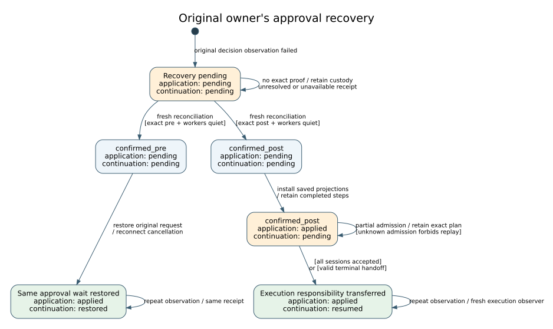
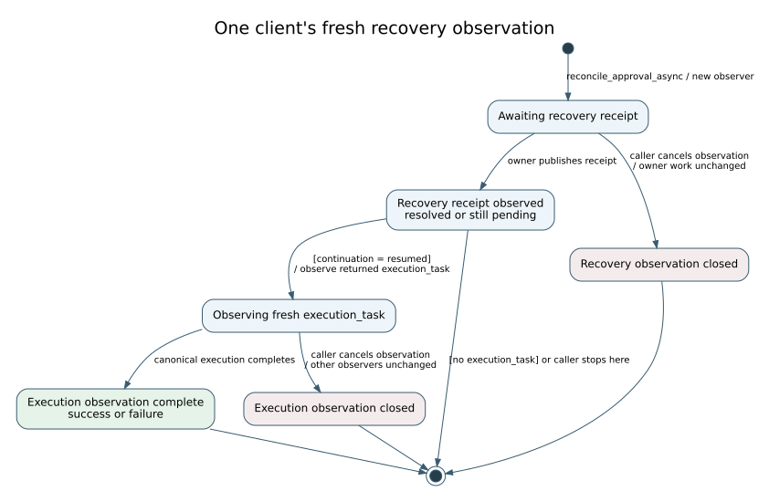

# Approval decision recovery model

This finite TLA+ model checks one original owner's captured standalone approval
transition. Durable decision evidence, local application, continuation admission,
physical worker completion, and each caller's observation are separate facts.
It complements the Ruby acceptance tests; it is not a refinement proof of Ruby or
an unbounded proof of all Agent, Team, Workflow, or remote-service behavior.

For example, an approval transaction may commit and lose its response. A later
`reconcile_approval` can confirm the exact saved decision, install its live
projections, and start the already approved Tool for the first time. Its storage
reconciliation is read-only, but the public operation can continue authorized
business work. It does not rerun the approval writer or an already accepted
session.

## State ownership and public observations

The owner retains the approval obligation until it restores the same wait or
transfers execution responsibility. A receipt describes that transition; its
completion is independent of completion of the overall Agent execution.

For example, `confirmed_post / applied / pending` means the saved decision has
been installed but some continuation responsibility is still retained. A
`confirmed_post / applied / resumed` receipt includes a fresh `execution_task`
observer. Cancelling that observer does not cancel the canonical execution or
another caller's observer.

| Public fact | Model source of truth | Meaning |
| --- | --- | --- |
| `confirmed_pre` | `owner.known = "pre"` | Exact unchanged wait or positive refusal before the initial worker could run. |
| `confirmed_post` | `owner.known = "post"` | Exact saved decision, including the captured approved/rejected value. |
| `unresolved` or `unavailable` | Unknown proof, missing completion evidence, or unavailable owner | These observation outcomes grant no application or replay permission. The model does not enumerate diagnostic error classes. |
| `application_state` | `owner.projection` | Zero or one local installation step is pending; both installed steps are applied. Restoration atomically represents the same wait and its binding. |
| `continuation_state` | `owner.handoff` | `none` is pending; `wait` is restored; `sessions` or `terminal` is resumed. |
| `physical_complete?` | `save.physical` and the active read's completion evidence | Save/read workers are quiet. It says nothing about resumed Tool, provider, or whole-job completion. |
| `resolved?` | Applied projection plus non-`none` handoff, after worker quiet | The approval obligation has ended; the Agent job may remain active or suspended. |
| `execution_task` | Independent `callers.execution[i]` | A fresh observation of one private canonical execution. |





These separate diagrams use UML-style state nodes, event/guard/action labels,
and initial/final markers. They are abstraction views, not a composed lifecycle
for both entities. Green owner states remain observable and are not Agent final
states. A client final marker ends only that observation. The original failed
approval observer stays closed throughout the model and never becomes one of the
fresh execution observers. `reconcile_approval_async` returns the cancellable
receipt observer shown; `reconcile_approval` waits for that observer on a host
thread and returns its receipt.

The diagrams omit physical slot phases, root/execution installation flags,
per-session identities and acceptance markers, and exact owner generations to
keep the abstraction readable. Those facts are explicit in the TLA+ model.
`DeliverPendingReceipt` abstracts a completed unresolved/unavailable or partial
receipt without enumerating its diagnostic cause; it does not alter owner work.

## Persistence proof and physical evidence

Application requires complete pre/post classification and physical completion
evidence. Worker return values and actual worker quiescence are distinct from
the owner's authoritative knowledge that a worker has stopped.

For example, a worker can record its result and become quiet after the submitter
lost its handle. The owner still retains the obligation because no completion
receipt is available. Neither an exception nor later absence permits cleanup.
The `witness-late-unknown` case demonstrates this reachable state.

The finite `Outcome` classes are `pre`, `post`, `divergent`, and a positive
`refused` initial submission. The model abstracts complete snapshot comparison as
one classification; it does not encode the individual root, execution, working,
journal, decision-content, and Tool-batch bytes. The persistence tests must check
that implementation boundary. The `revision_only` mutation deliberately treats
a divergent snapshot as post-state, and `CompleteEvidence` rejects it.

A lost save/read handle is retained even if the worker later stops. Initial
positive refusal is a premise about the submitter's truthful pre-enqueue receipt;
it is not inferred from the exception type. Capture/encoding failures before a
complete proposal, backend atomicity, remote transaction settlement, and
replacement-process reconstruction are outside this model's proof boundary.

## Partial continuation and cancellation

The continuation plan contains stable parent and child identities. Admission is
an irreversible historical fact, independent of whether the session is still
present or has already finished. Terminal transfer can abandon only sessions
known not to have been admitted.

For example, the parent and first child may be accepted before registering the
second child fails. A later explicit reconciliation registers only that missing
child. If the first child has already performed its Tool and disappeared from
the EventLoop, its absence cannot authorize another registration or Tool effect.
The partial-plan restart and late-absence mutations expose both errors.

The `AdmissionQuery` premise represents an authoritative query immediately after
a registration exception on the same owner turn, before queued starts run. It
is not a later lookup of a possibly completed session. With no such query, an
actually accepted session can remain uncertain; the owner retains the plan and
cannot claim resolution. `missing-admission-query` is the corresponding progress
counterexample.

Cancellation of the original invocation is separate from cancellation of a
receipt or execution observer. Confirmed pre-state reconnects the original
cancellation binding and processes a previously requested cancellation. On the
post path, a cancelled accepted parent must actually reach its terminal callback
before terminal transfer abandons known unadmitted children. Unknown child
admission still prevents this transfer. `resumed` therefore means responsibility
has transferred, not that every child ran or succeeded.

## Bounds, scheduling, and progress premises

The model explores a finite transition unit, including intentionally conservative
interleavings between partial local steps. Its safety checks need no fairness;
progress checks assume the required owner and workers continue to act.

For example, a stopped original Runtime can retain an unresolved obligation
forever without violating safety. It does violate a claim that every recovery
must eventually resolve. No such unconditional progress claim is made here.

The bounds are one captured decision, one initial save, at most two read attempts,
one parent and two children, two owner generations, and two named fresh client
observers. Admission/effect counters reach two so duplicate behavior is visible
to mutations. `ObserveClients = FALSE` omits client interleavings from core fault
cases; the dedicated observer safety and mutation cases include both clients.
`FreshObservation` abstracts further explicit caller requests without adding more
observer identities; it is not an automatic background retry.

`ProgressSpec` adds weak fairness for worker execution/completion observation,
explicit fresh caller wakeups, classification, missing application steps,
registration, restored cancellation processing, and valid handoff. Positive
progress cases require all of the following:

- The exact original owner remains live and no new owner/request generation takes
  its authority; no shutdown or owner replacement occurs.
- The durable snapshot is exact pre/post, or initial refusal is positively proved.
- Submitted workers finish and usable physical completion evidence remains
  available; authoritative reads finish with the expected classification.
- A fresh caller explicitly requests recovery after each retained interruption.
- A registration exception has an immediate authoritative admission query; the
  one injected installation or registration fault does not recur forever.

The model does not promise eventual provider or Tool completion. Its progress
endpoint is restoration or responsibility transfer. Child effects can finish
later. The missing-caller and missing-query cases intentionally violate the
progress premise and must produce temporal counterexamples.

## Current implementation mapping (2026-11-28)

The Agent approval owner uses C13 `RetainedAttempts` for the initial attempt,
one recovery lane, admission facts and observer membership, and
`AttemptCompletion` for worker results and logical/physical evidence. The owner
retains proof classification, same-wait restoration, partial continuation and responsibility transfer. The current command, snapshot and mutex boundaries are documented in
[shared retained-attempt management](../../../docs/architecture/retained-attempts.md).

For example, an observer can finish while the save worker is still running.
The shared manager keeps the physical lane and recorded worker facts; the owner
later decides what those facts authorize. Registering an inline callback or
merging a stale task snapshot is still a concrete Ruby implementation obligation.

This mapping update does not change the TLA+ transitions, configuration bounds,
expected counterexamples or progress premises. The models do not count mutex
acquisitions or enumerate partial callback registration. Fresh protocol-model
runs and their exact input hashes are recorded in delivery evidence; neither a
fresh run nor this correspondence table proves refinement of the Ruby code.

## Checks and reproducibility

The runner distinguishes successful property checks, expected mutation failures,
reachable-state witnesses, and missing-premise liveness failures. Matching an
expected negative result means the check detected its intended condition; it is
not a passing implementation trace or an unresolved defect in the normal model.

For example, `bug-absence-replay` intentionally clears a completed child's
accepted marker. TLC then finds two effects for the same child. By contrast,
`witness-independent-observers` negates a desired state so TLC can produce a trace
where one execution observer is cancelled while another completes.

There are 29 configurations: six safety checks, six conditional progress checks,
nine mutation checks, six reachability witnesses, and two missing-premise checks.
`cases.json` records exact constants and expected targets. Negative configurations
check their named invariant plus type correctness so an earlier, different
invariant does not obscure the intended counterexample.

Run with Java and a pinned `tla2tools-1.7.4.jar` (SHA-256
`936a262061c914694dfd669a543be24573c45d5aa0ff20a8b96b23d01e050e88`):

```sh
python spec/models/approval_decision_recovery/run_checks.py \
  --jar /absolute/path/to/tla2tools-1.7.4.jar \
  --output /absolute/path/outside-the-model-source
```

The output contains exact commands, source/JAR hashes, Java version, exit codes,
state counts, and TLC logs. Generated output must remain outside this source
directory. Regenerate the diagrams with Graphviz:

```sh
dot -Tsvg spec/models/approval_decision_recovery/approval-owner.dot \
  -o spec/models/approval_decision_recovery/approval-owner.svg
dot -Tsvg spec/models/approval_decision_recovery/approval-client.dot \
  -o spec/models/approval_decision_recovery/approval-client.svg
```
