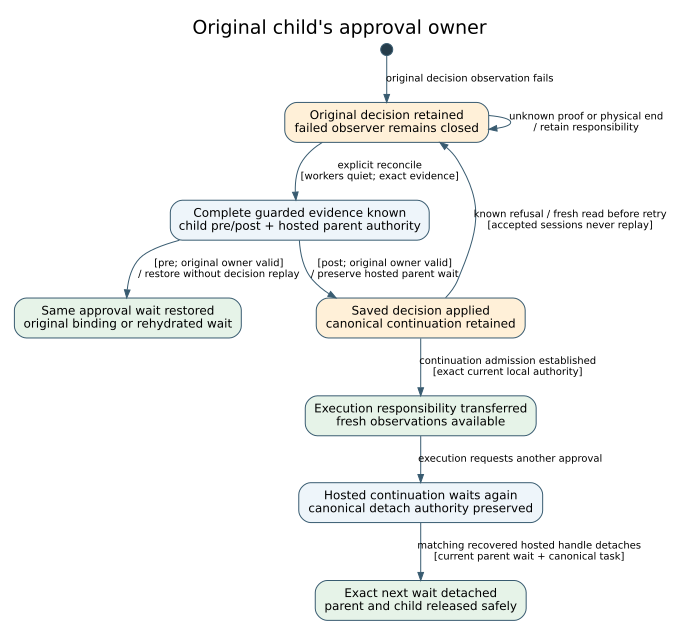
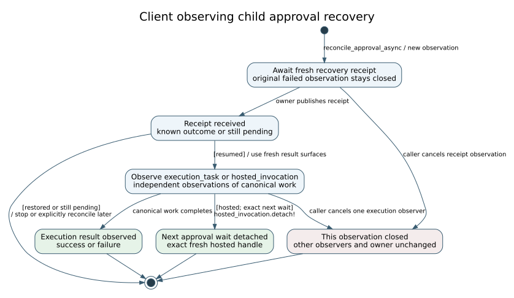

# Child and rehydrated approval recovery model

This focused finite model checks the authority needed to recover an approval on
an original child or rehydrated Agent and to preserve a hosted continuation's
next approval boundary. The existing
[`approval_decision_recovery`](../approval_decision_recovery/README.md) model
already checks detailed save/read completion, partial session registration and
cancellation transfer. This model complements that protocol with correlated
ownership, parent evidence and host-handle lifetime; it does not duplicate every
session or prove a refinement of the Ruby implementation.

For example, a report parent waits for its native child to approve a protected
Tool. The approval decision commits but its reply is lost. Reconciliation must
use the same child, and a restored parent's hosted decision must also retain its
exact parent authority. If the continued child asks for approval again, the
recovered hosted handle must still be able to detach that exact new wait.

## Distinguish the three ownership paths

The modes share one original approval responsibility but differ in the local
cancellation binding and the extra authority attached to a hosted continuation.
A reservation does not make a child standalone, and absence of a suspended
callback after loading does not prove that the original approval never existed.

For example, a directly running child restores its exact suspended binding on a
confirmed pre-state. An Agent loaded from a committed approval wait restores that
loaded wait without inventing a previous callback. A restored parent's hosted
decision additionally carries the parent's exact recovered coordination wait.

| Mode | Captured child proof | Local restoration | Extra hosted authority |
| --- | --- | --- | --- |
| `direct` | Complete original child state, including opaque reservation and retentions | Same suspended binding | None; existing parent cancellation propagation remains responsible |
| `rehydrated` | Complete loaded approval state | Loaded wait with no prior suspended callback | None; no hosted handle is added by recovery |
| `hosted` | Complete original child state plus complete guarded parent footprint | Loaded child wait with no prior callback | Original live parent/child context, exact parent wait and canonical approval task |

The model abstracts complete bytes and records into `durable.child` and the
parent revision/cancellation fields. The implementation's persistence tests check
root, execution, extension content, journals, cancellation and retentions. A
child-only post-state is never sufficient proof for a hosted decision.

The initial state already contains one failed original observation and the retained
captured decision evidence. Atomic authority capture, the original decision write
and exact serialization of that evidence are premises exercised by Ruby tests.
The original worker may still be physically active. This model checks later
classification, application, admission and hosted lifetime from that boundary.





These are separate UML-style state views, not one shared state machine. Green
owner states mark a responsibility boundary, not successful completion of the
entire Agent job. A client final marker ends only that observation. The detailed
model additionally tracks physical completion, stale owner generations, exact
parent waits and receipt/task identity.

## Preserve authority across a failed observation

The original failed observation stays closed. Recovery returns new observation
surfaces for the retained execution; a hosted surface separately carries the
canonical task needed to detach a later approval. Closing one observer must not
cancel canonical work or another observer.

For example, a resumed hosted receipt contains `execution_task` and
`hosted_invocation`. Their execution observations are independent, even though
both refer to the same canonical `ApprovalOperation` and original parent wait.
Cancelling the first observation does not close the hosted one. The old failed
hosted handle cannot adopt the recovered canonical task.

The model's two named observers represent independent execution observations.
They can stand for observations returned to two callers or for the task and host
surfaces of one receipt. This abstracts surface construction, while preserving
independence and the shared canonical detach authority. `detachKey = 1` represents
the exact original canonical task, not a transferable public identifier. Multiple
fresh hosted handles may refer to that task, but only the first valid detach can
succeed; after detachment no matching live wait remains.

`HostedCanonicalAuthority`, `FreshHandleAuthority` and `DetachAuthority` reject a
plain replacement task, an old handle or stale local parent wait. If the original
hosted context is no longer available, a later receipt may still observe execution
without manufacturing a new hosted capability. The model represents that as no
new hosted handle. The model separates completion of the decision worker from
physical completion of the canonical execution. Only the latter permits normal context retirement,
and later receipts must not issue a new hosted handle. Existing handle objects
can remain as stale values, but no matching active approval wait remains. The
`save_end_retires_context` mutation detects retiring authority at the earlier
decision-worker boundary. Detailed weak-reference cleanup and Ruby object lifetime
are covered by implementation tests, not by garbage collection in TLA+.

## Recheck parent evidence before another admission

A refused continuation attempt ends its authorization unit. A later observation
must reread the hosted parent footprint and validate the exact local parent wait
before attempting any still-unadmitted work. A previously accepted or uncertain
admission is never restored to permission to dispatch.

For example, the first observation applies the child's saved post-state but its
session submission is positively refused. The parent revision then changes.
Reusing the earlier post-state proof would let a second observation resume under
obsolete authority. The normal model rereads and remains held; the
`bug-cached-parent-proof` case detects the unsafe cached alternative.

The model represents one abstract continuation admission. The generic approval
model checks its finer parent/child session plan. `lost_admission_reply` models
actual admission without an acknowledgement; matching progress from that exact
session can establish acceptance, while a missing session or a retry request
cannot establish that admission never happened. `NoAdmissionReplay` rejects the
alternative that treats uncertainty as permission to start again.

Physical worker return and the owner's physical completion evidence remain
separate. A save worker that finishes after its handle is lost does not release
the obligation. `UnknownPhysicalCustody` and the late-return witness check this
boundary. Reconciliation in this model performs no approval writes; a confirmed
pre-state restores the wait for a later explicit decision.

## Bound the read-to-dispatch guarantee

A guarded durable read and a later EventLoop action are separate events. The
normal safety profile assumes cooperative writers keep the checked parent
footprint stable while that observation's authorization is consumed. It also
checks the current local parent wait immediately before live application and
admission. This is not a distributed fence extending a storage lock through
external dispatch.

For example, if an unrelated writer cancels or replaces the durable parent after
the guarded read returns but before the child dispatches, a fresh read alone
cannot prevent that race. `missing-parent-stability` deliberately removes the
stability premise and finds an `AuthorityAtAdmission` counterexample. This is a
reported limit of the claimed protocol, not a passing implementation trace or a
hidden atomicity assumption. New multi-writer fencing is not supplied here.

With `ParentStable = TRUE`, parent changes may occur before a read or between a
refused attempt and the next fresh observation. Changes at those boundaries are
checked normally. With `ParentStable = FALSE`, the external writer can also
change authority after the read and before admission. Cancellation after a valid
read follows the existing cooperative cancellation mechanism and does not undo
already admitted business effects. The model deliberately does not claim
`NoDispatchAfterConcurrentCancel` for arbitrary writers. The captured child
footprint is likewise stable between the returned read and its owner application;
`ChangeChild` explores changes before that read returns. Exact local child-owner
generation is checked independently. The model does not turn a prior child
snapshot into an atomic check of current durable cancellation at dispatch.

A captured direct-child cancellation or a rejected approval produces no protected
Tool effect in this model. Hosted authority captures both parent and child; a new
child cancellation or retention change between capture and the worker is a
divergent child footprint and does not authorize the decision write. Parent
cancellation already present at the hosted read prevents classification and keeps the obligation retained. Direct-child parent
progress is not frozen by the hosted-only footprint rule.

## Separate safety, progress and negative checks

Safety is checked without fairness. Conditional progress additionally requires
an available original owner/context, usable physical completion evidence,
readable exact storage, an explicit fresh caller and fair execution of enabled
protocol steps. A permanently unavailable owner or Store may safely retain the
obligation indefinitely.

For example, `missing-fresh-caller` demonstrates that retained recovery is not an
automatic background process. `missing-readable-store` and
`missing-physical-proof` similarly reject unconditional eventual-resolution
claims. `next-hosted-detach-progress` reaches the next committed approval wait and
valid detach only while the exact host authority remains available and callers
do not cancel all observations.

The finite bounds are one original decision/save, at most two read attempts and
two submission attempts, one abstract continuation, two observer identities, two
owner/parent generations and one subsequent approval boundary. Counters permit
two admissions/effects so replay mutations are observable. A post-detach reload
and second decision are exercised by Ruby acceptance rather than expanded into
an unbounded sequence here.

The 48 configurations comprise 20 property checks (11 safety and 9 conditional
progress), 17 deliberate mutations, seven reachability witnesses and four
missing-premise checks. `cases.json` is the authoritative inventory. A negative
case matches only its named invariant or temporal counterexample; no unrelated
violation is accepted as success. Witnesses negate a desired reachable state so
TLC can emit a concrete trace. Normal-model property checks must report no error.

## Reproduce the checks and diagrams

The runner records the exact model, configuration, tool and source hashes along
with commands, Java version, exit codes, state counts and full TLC logs. Output
stays outside the source directory so generated exploration state cannot become
part of the model evidence.

For example, run all configurations with the pinned TLC JAR below. The runner
rejects a JAR whose SHA-256 differs from
`936a262061c914694dfd669a543be24573c45d5aa0ff20a8b96b23d01e050e88`.

```sh
python3 spec/models/child_approval_recovery/run_checks.py \
  --jar /absolute/path/to/tla2tools-1.7.4.jar \
  --output /absolute/path/outside-the-model-source

dot -Tsvg spec/models/child_approval_recovery/child-approval-owner.dot \
  -o spec/models/child_approval_recovery/child-approval-owner.svg
dot -Tsvg spec/models/child_approval_recovery/child-approval-client.dot \
  -o spec/models/child_approval_recovery/child-approval-client.svg
```

This model does not establish arbitrary participant recovery, process-loss
reconstruction, selected production-backend conformance or universal exactly-once
external effects. Those obligations remain separate from this bounded live-owner
approval repair.
