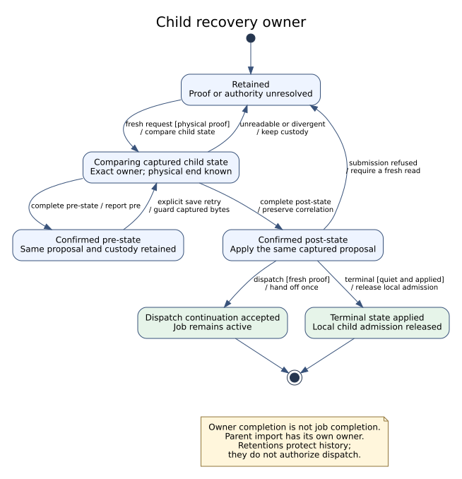
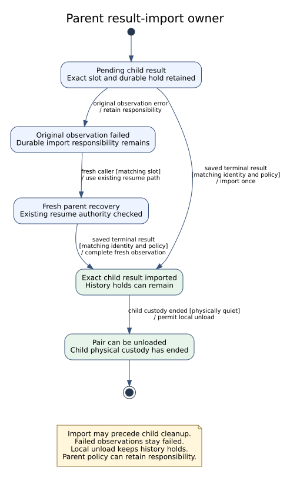
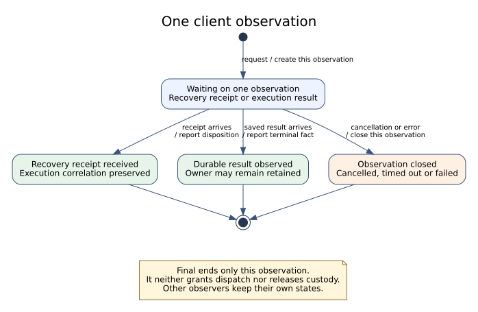

# Correlated child execution recovery model

This finite model separates a child's retained recovery owner, its parent's result-import responsibility and each caller's observation. It checks the new correlation boundary for pre-dispatch and actual terminal saves while retaining the existing standalone recovery models as evidence for their detailed local protocols. It does not prove a formal composition theorem or refinement of the Ruby implementation.

For example, a report Orchestrator's reserved worker saves its answer, but both the response and immediate readback fail. The public exact-execution wrapper may nevertheless observe the saved terminal answer and let the parent import it. The child can still retain a recovery owner until its own exact proof, live application and physical cleanup finish. These are compatible states, not contradictory results.

The applied baseline is `ae2070e36687f376754128deea1a41c69f416a0c`. Contract concept v55 and foundation v48 remain the architectural references. This model adds no public API, job manager or automatic parent retry.

## Keep the three state machines separate

The child owner applies its captured proposal and controls its local admission. The parent import owner protects and consumes a matching child result. A caller controls only the lifetime of its observation. Their actions become events for one another without making their internal states identical.

For example, a parent can import a durable result while the child still holds physical recovery custody. Pair unloading must wait for that child custody to end; an already failed parent observation instead needs a fresh caller using the existing resume path.







The diagrams are separate UML-style views with event, guard and action labels. A child's green dispatch state ends preparation ownership, not the continuing job. A parent's imported state is not a guarantee that all later parent business work finishes. A client's final marker ends only that observation.

| Entity | Model record | Responsibility |
| --- | --- | --- |
| Original persistence attempt | `save` | Separate actual return from authoritative knowledge of physical completion. |
| Persisted child and parent relationship | `durable` | Keep the exact child footprint, terminal fact, parent slot and durable hold distinct. |
| One recovery lane | `worker` | Read or explicitly retry the captured proposal without recomputing business work. |
| Original child execution owner | `owner` | Apply once, grant a dispatch continuation at most once, and release only the corresponding local responsibility. |
| Parent result-import owner | `parent` | Import the exact result under an existing valid parent authority, or wait for an explicit fresh resume caller. |
| Original and fresh observations | `clients` | Preserve closed outcomes and keep execution observation separate from local recovery completion. |

The internal original invocation begins failed at this abstraction boundary. Its public exact-execution wrapper is a different observation: it can close with an error or with a saved terminal fact. The model therefore does not infer a public error merely from a retained terminal owner. A separately requested durable execution observation is represented independently as well.

## Compare the child footprint without treating holds as authority

The child proof compares the original Agent state and execution state, including its opaque correlation. Parent progress and changes to history-retention references do not become new dispatch permissions and do not automatically invalidate an already computed child terminal result.

For example, importing a completed worker marks the parent slot as imported while native history holds remain. A later authorized history-release operation can remove a hold. Requiring the original retention set during the child's subsequent terminal reconciliation would leave an otherwise valid child owner stuck. Conversely, possession of a hold cannot authorize dispatch if the child's saved execution or cancellation state has changed.

`ExecutionChange.read_agent_evidence` supplies the five-field footprint abstracted by `Before` and `After`:

1. Agent root.
2. Execution, including opaque reservation metadata.
3. Journal records from the captured root position.
4. Referenced execution-extension content, or nil.
5. Durable cancellation state.

The Ruby proof also checks the journal head against the captured root position and uses a nil participant-evidence member on this supported path. Record encoding, exact journal records, content-addressed terminal bytes and Store identity are implementation and existing persistence-model obligations. The five model fields distinguish identity changes without reproducing arbitrary JSON values.

Retentions are deliberately excluded from this footprint. `parentHold` protects an unimported result in the selected native scenario; `holdVersion` represents legitimate hold-set changes. Parent revision may advance independently. Mutations that freeze the parent revision or require the original hold version produce progress counterexamples. A mutation that treats a hold as authorization instead produces an invalid-proof counterexample.

The model assumes other valid participants preserve result custody until import or another authorized disposition. It explicitly models import; arbitrary external deletion, administrative abandonment and other disposition protocols are outside the finite scenario. This is not a new guarantee that every writer or retention backend obeys those rules.

## Revalidate a dispatch grant after uncertainty

A prior saved post-state is a historical fact. A still-unadmitted dispatch continuation needs fresh complete child proof before another grant, as well as the exact live owner and physical completion evidence. A saved proof does not resolve prior external admission uncertainty.

For example, the owner applies a prepared child proposal, but the first continuation submission is positively refused. The child's durable cancellation or reservation then changes. A later read must leave the operation unresolved; retaining the historical `post` fact cannot authorize a second attempt from the old proof.

The model preserves `owner.known = post` across later unknown reads but clears `owner.fresh`. `bug-cached-post-grant` admits from that obsolete authorization and must fail `FreshProofBeforeGrant`. `ChangeFootprint` can alter any of the five captured fields. The five corresponding omission mutations verify that each field is relevant to complete proof.

`StableRead = TRUE` assumes cooperating writers keep the checked child footprint stable between the guarded read and the owner's use of that read. Parent progress and hold changes remain independent. `missing-read-stability` removes the child-stability premise and detects the read-to-admission race. The model does not turn a guarded read into a distributed lock extending through external dispatch.

A local cancellation observed before the grant routes the same continuation to cancellation without a new external admission. A later or concurrent remote cancellation follows existing cooperative cancellation semantics; no instantaneous cross-process cancellation fence is claimed. The normal initial successful dispatch's transaction proof is outside this model's failed-observation starting boundary.

## Preserve terminal facts and parent result custody

A terminal recovery applies an already computed success, failure or cancellation fact. It does not recompute that outcome, replay the Provider or Tool, or require the parent to remain at an old revision. Child local release and parent result import remain independent decisions.

For example, on saved post-state the existing exact-execution wrapper can supply the child result to a still-live parent before the child reconciles. On saved pre-state the parent may fail and retain its durable pending slot. After an explicit captured-byte retry, a fresh parent resume caller can import the same child's result. The old failed parent observation remains failed.

The model distinguishes `terminalSaved` from the complete child owner's five-field proof. A matching stored terminal execution can be observed or imported even if unrelated root or journal changes prevent the child owner's full proof from matching. Neither observation clears child recovery custody. This is also why `ImportChild` is enabled before child physical return or local reconciliation.

`ReleaseChild` clears local admission only for terminal mode. It leaves the parent's pending durable hold unchanged. `ImportChild` consumes the matching result once and leaves history holds unchanged. The optional `ReleaseImportedHistory` environment action represents a separate authorized history-release request; fairness does not require that action. `UnloadPair` releases only local objects and additionally requires the child's local admission, retained owner and physical obligations to have ended. The mutations for dropping the hold on release and unloading after parent import detect premature cleanup.

The current parent path is represented by an exact slot and generation. `ParentPolicyAllowsImport` is an explicit applicability premise, not a new retry policy. With the default required-child failure policy, a failed or cancelled child can leave the parent failed with `imported = false` and history holds retained. Child recovery still completes; unconditional parent import and pair unloading are not promised. `missing-parent-import-policy` exhibits that progress limitation even when a fresh caller exists.

The parent policy and its child result are separate from observation success. A failed original parent observation needs `ResumeParent`, an abstraction of the existing authorized resume path invoked by a new caller. The model does not implement or imply automatic resurrection of the parent task. Success, failure and cancellation are parameters of the saved child fact, not claims that the parent application treats all three outcomes identically.

## Keep observation and recovery completion independent

A receipt describes proof and application progress; an exact-execution observation describes a saved execution result. Either can finish while another participant still owns physical cleanup. Cancelling a receipt changes only that receipt.

For example, a client can observe the saved answer through `Store#observe_execution` while the original child owner remains unresolved. A later terminal recovery receipt must preserve the same opaque reservation in its returned execution observation. Dropping that correlation would change the identity presented to applications even when the saved result was correct.

`ReceiptCorrelationPreserved` checks this returned identity. The original internal invocation, its public wrapper, the original parent observation and new receipts have separate state. `ClosedOriginalsStayClosed` preserves whichever result the public wrapper actually closed with, rather than forcing every original public observation to be an error. `ClosedObserversStayClosed` keeps cancelled receipts final.

## Check safety, progress and intended counterexamples

Safety properties express obligations under each finite interleaving profile. Progress properties add explicit availability and fairness premises. Mutants and reachability witnesses intentionally produce named counterexamples and must not be reported as defects in the correct protocol.

For example, the imported-parent witness reaches a state where the parent has consumed the durable child result while the child still lacks physical completion proof. The pair-unload mutation incorrectly treats that parent import as sufficient cleanup authority, and the checker rejects it.

| Property family | Meaning |
| --- | --- |
| Complete child proof and fresh grant | Preserve the opaque execution correlation and all five child fields; historical post-state alone cannot grant a new dispatch. |
| Physical and local ownership | Require physical evidence and the exact retained child incarnation before application and release. |
| Replay prevention | Reads and captured-byte retries do not repeat preparation, business effects or external admission. |
| Parent custody and import | Local child release preserves pending durable responsibility; only the exact parent slot imports once. |
| Pair cleanup | Parent import or an observed terminal result cannot unload a child still retaining physical responsibility. |
| Observation identity and closure | Preserve public execution correlation and independent closed outcomes. |

The authoritative `cases.json` inventory contains 59 configurations:

- 25 positive property checks: 14 safety profiles and 11 conditional progress profiles.
- 16 deliberate mutations: 14 invariant counterexamples and two progress counterexamples.
- 11 reachability witnesses.
- Seven missing-premise checks: readable Store, physical evidence, backend settlement, explicit save retry, explicit parent caller, applicable parent import policy and child read-to-application stability.

Conditional child progress requires the original owner, complete settled readable proof, usable physical evidence, explicit callers and fair scheduling. Confirmed pre-state additionally requires an explicit save-only retry. Parent import requires the matching result, a policy that permits import, and an existing authorized importer or fresh resume caller. Subsequent parent business completion is not modeled.

Bounds are one child proposal, one parent slot, two owner/correlation generations, one original save, one serialized recovery lane with at most three attempts, two client receipts and one bounded external interference. The third attempt permits a pre-state retry whose write succeeds but reply is lost, followed by a confirming read. Replay counters permit invalid second executions so their safety properties are observable. The saved terminal result kind is a parameter.

## Reproduce verification and diagrams

The runner checks each configuration's exact expected class of result and records complete logs, tool versions, commands and source hashes outside the source directory. A negative case succeeds only when TLC reports its named invariant or intended temporal counterexample.

For example, the following command executes all configurations with the same pinned TLC JAR used for the preceding approval model:

```sh
python3 spec/models/child_execution_recovery/run_checks.py \
  --jar /absolute/path/to/tla2tools-1.7.4.jar \
  --output /absolute/path/outside-the-model-source

dot -Tsvg spec/models/child_execution_recovery/child-owner.dot \
  -o spec/models/child_execution_recovery/child-owner.svg
dot -Tsvg spec/models/child_execution_recovery/parent-owner.dot \
  -o spec/models/child_execution_recovery/parent-owner.svg
dot -Tsvg spec/models/child_execution_recovery/client-observer.dot \
  -o spec/models/child_execution_recovery/client-observer.svg
```

The required JAR SHA-256 is `936a262061c914694dfd669a543be24573c45d5aa0ff20a8b96b23d01e050e88`. Graphviz is only needed to regenerate the SVGs. Initial proof capture and encoding, actual content integrity, Ruby projection and callback behavior, exact parent resume APIs and backend conformance are checked outside this abstraction. Participant/Handoff recovery, nonterminal wait establishment, stopped-Runtime administration, process-loss recovery and universal exactly-once external effects remain separate obligations.
