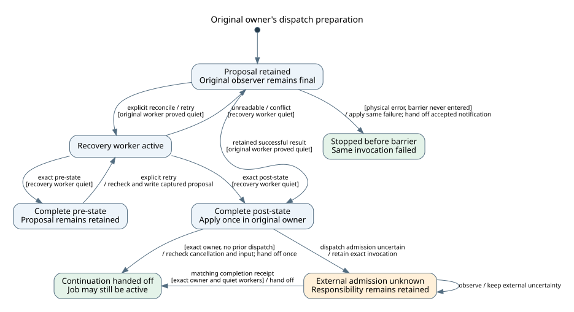
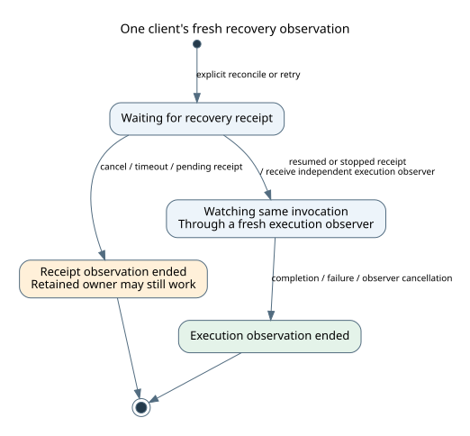

# Dispatch preparation recovery model

This finite TLA+ model checks one original Agent owner's retained pre-dispatch
persistence proposal. Complete persistence proof, physical worker completion,
continuation admission, and caller observations are separate facts. It supports
Provider and Tool preparation under the same protocol abstraction. It does not
prove refinement of the Ruby implementation or exactly-once external effects.

For example, a report Agent prepares a Tool call, the barrier transaction commits,
and both the save response and its immediate readback are lost. The original
caller sees a failure. A fresh reconciliation can establish the complete saved
proposal, install it once, and continue that same invocation. Confirming the save
alone does not establish that an external call was never admitted.

## Separate owners and observations

The preparation owner retains an unfinished responsibility until it hands the
same invocation to an authoritative continuation. Each caller owns only its
observation. Ending that observation neither stops a save worker nor abandons
the retained proposal.

For example, cancelling one reconciliation receipt leaves another caller's
receipt and execution observer usable. The original failed invocation observer
never becomes successful later; a resumed receipt supplies a fresh execution
observation of the same canonical invocation.





The diagrams are separate UML-style abstraction views with event, guard and
action labels. The owner's green states end preparation custody. A resumed job may remain
active; a stopped-before-barrier continuation reports the original setup failure. The client final marker ends only that observation. Physical worker
phases and exact generation checks are explicit in the model, rather than extra
states in these high-level diagrams.

| Entity | Model record | Responsibility |
| --- | --- | --- |
| Original persistence attempt | `save` | Enter, record, physically return, and expose reliable completion evidence. |
| Storage authority | `storage` | Classify the complete pre/post footprint, settle the original transaction, and enforce the retained proposal's write guard. |
| One recovery worker | `worker` | Read or explicitly retry the captured proposal; retain result and physical completion separately. |
| Original execution owner | `owner` | Preserve the exact generation, apply the confirmed proposal once, recheck cancellation, and hand off once. |
| External dispatch knowledge | `dispatch` | Distinguish no prior admission, acknowledged admission, and uncertain admission. |
| Client observations | `clients` | Keep the original error immutable and provide independent receipt and execution observations. |

## Persistence evidence and explicit retry

A read-only reconciliation may classify complete pre-state or complete post-state.
Only an explicit retry can write the previously captured proposal, and that
retry rechecks its complete precondition in its own worker. Business preparation
and external invocation are not replayed to reconstruct evidence.

For example, observing pre-state on Monday does not authorize a write after
another writer changes the record. The retry compares the current footprint
again and enforces its guard at commit. `bug-stale-pre-write` removes that guard
and the checker rejects the mutation. `bug-rebuild-proposal` models rerunning
hooks or Policy to reconstruct input and is rejected separately.

`Outcome` represents the original transaction's complete `pre`, `post`, or
`third` state. The classification abstracts all required root, execution,
journal, extension, cancellation and participant evidence; it is not a revision
comparison. The Ruby persistence tests must establish the actual footprint.
`CompleteProposal = FALSE` prevents recovery when the finalized proposal is
absent. It does not grant permission to prepare again.

A retained successful initial result can supply complete post-state proof without
a new storage read once the original worker is proved quiet. `InitialProof =
post` represents that authoritative successful result, including the backend
settlement it promises. `initial-post-without-read-progress` keeps storage reads
unavailable and rejects Ready delivery, yet still reaches the same-owner
continuation through the retained result. It is not proof inferred from a local
exception or from physical return alone.

The original transaction's settlement is independent of local physical return.
`SettleSave` can occur after `SaveQuiet`. When settlement is not established,
reads cannot produce authorizing proof. This is a capability premise about the
selected backend and its evidence, not a guarantee that any generic snapshot
read can discover the absence of a remotely pending transaction. The
`local_return_is_settlement` mutation turns a local return into settlement and
must fail `SettledPreEvidence`.

A retry that commits but loses its response leaves the proposal retained; another
read can confirm the post-state. Only one original worker and one recovery worker
are represented. Recovery workers are serialized; repeated explicit observations
reuse that bounded slot rather than creating overlapping writes.

## Failure before the barrier

A preparation failure can be stopped without reconstructing input only when
physical completion and positive evidence establish that the persistence barrier
was never entered. Missing captured proposal data alone does not establish that
fact. The owner still retains responsibility until the original setup-failure
continuation is accepted.

For example, input conversion raises before the barrier starts, but the original
FSM's failure notification is positively rejected. A fresh recovery may classify
`not_prepared`, apply the unchanged original execution's failure decision, and
retry that notification. Once accepted, the result is `not_prepared / applied /
stopped`, with a fresh execution observer for the same failed invocation. Neither
hooks, preparation nor external business work runs again.

`BarrierEntered = FALSE`, `InitialProof = error`, absent complete proposal and
proved physical completion represent the authoritative never-entered receipt.
The model's preparation worker can enter and return, but no persistence write is
attempted in this branch. Positive submission refusal before the worker entered
is another implementation route to the same no-write fact; the model abstracts
both routes at their completed, authoritative receipt. It does not infer this
receipt merely from an exception, a missing task handle or missing proposal.

`ClassifyNotPrepared`, `InstallUnpreparedStop` and `HandOffUnpreparedStop` preserve
the pending/applied/stopped distinctions. The final handoff uses the same
`ContinuationAvailable` abstraction as other local failure notifications. A
permanently refused notification retains custody and fails the unconditional
progress check. The `missing_proposal_is_no_write` mutation deliberately treats
missing proposal after an entered barrier as no-write proof; `PositiveNoWriteProof`
rejects it. `StoppedWithoutDispatch` forbids an external admission on this path.

The local delivery wrapper's notification retry covers progress while the
original handoff is open. Notifications emitted asynchronously after that
handoff is sealed retain their existing contract; this model does not extend it.

## Application, cancellation and dispatch

Applying a saved proposal and admitting its external continuation require
separate permissions. The owner must possess complete post-state evidence,
physical completion evidence and the exact live identity before application.
It must also exclude prior or uncertain dispatch admission before authorizing
the original external call.

For example, cancellation can become authoritative after a barrier commits but
before dispatch. The owner installs the saved execution and routes the same
continuation into cancellation without calling the Provider or Tool. A
post-commit materialization failure similarly routes failure without dispatch.
The receipt's resumed continuation is therefore not a claim of business success.
The distinct stopped continuation described above ends an initial setup that
never entered the persistence barrier.

The model treats that local continuation handoff as one atomic owner decision.
`ContinuationAvailable = FALSE` prevents a handoff and keeps custody. The
`missing-continuation-admission` case demonstrates that permanent refusal of a
local failure notification invalidates unconditional progress. Detailed enqueue
receipts and positive non-admission permitting a retry of that local control
message are implementation-test obligations; they do not permit retrying an
external business dispatch.
`owner.continuation` distinguishes normal resumption, cancellation and
materialization failure for verification; these are not additional public enum
values. Public `continuation_state: resumed` encompasses each accepted handoff.
`ReleasePreparation` requires that handoff and quiet workers. It does not release
the Agent's continuing job or any downstream resource responsibility.

`InitialDispatch = accepted` or `unknown` represents an already crossed external
boundary. Storage reconciliation does not replay that call or resolve its
external outcome. An unknown registration after the local dispatch decision is
also retained when its effect actually completes but no authoritative completion
receipt is available. `AcceptMatchingCompletion` requires the exact owner's
correlated completion receipt, complete post-state application and quiet workers.
It transfers the same invocation without incrementing dispatch admissions. The
unknown-admission progress case checks this path; removing the matching receipt
produces the expected liveness counterexample. A stale-generation completion is
rejected by a separate mutation check. Other external-outcome resolution remains
outside this model. Absence of an active session is never non-admission proof.

## Safety properties and expected counterexamples

Safety checks state what must remain true under arbitrary permitted interleaving.
The negative cases intentionally break one rule and must produce the named
counterexample. Reachability witnesses intentionally negate a desired reachable
state and must also fail; they are not defects in the correct protocol.

For example, `witness-ready-rejected-recovery` requires a trace where a Ready
notification was rejected but an explicit later recovery still completes the
handoff. `bug-ready-drops-custody` instead models the invalid implementation that
forgets the proposal when that notification is rejected.

| Property | Required guarantee |
| --- | --- |
| `CompleteEvidence`, `SettledPreEvidence` | Classified proof uses the complete, settled storage state. |
| `PositiveNoWriteProof`, `StoppedWithoutDispatch` | A stopped setup has positive never-entered proof and never dispatches external work. |
| `NoStaleProposalWrite`, `NoPreparationReplay` | A retry uses the captured proposal and a fresh enforced precondition. |
| `NoWorkerOverlap`, `PhysicalBeforeApplication` | Observer completion does not authorize overlapping workers or early application. |
| `SingleApplication`, `ExactOwnerMutation` | The original proposal is installed at most once by the correct owner generation. |
| `SingleDispatch`, `ProofBeforeDispatch` | No repeated original dispatch or dispatch authorized without saved proof. |
| `CancellationBeforeDispatch`, `MaterializationBeforeDispatch` | Cancellation or failed input materialization prevents a new external call. |
| `CustodyUntilHandoff`, `UnknownCustody`, `QuietBeforeRelease` | Responsibility remains until a proved, physically safe continuation handoff. |
| `ClosedOriginalStaysClosed`, `ClosedObserversStayClosed`, `IndependentObservers` | Old observations remain final; cancelling one does not cancel another. |

## Conditional progress and limits

Progress requires an available original owner, truthful physical completion,
readable and settled storage, complete captured evidence, an available
continuation admission path, and explicit callers.
A confirmed pre-state additionally requires an explicit retry caller. Fairness
assumes enabled protocol work is eventually scheduled; it does not repair a
permanently stopped Runtime or an unknowable external admission.

For example, `post-progress` checks eventual handoff under those conditions,
while `missing-physical-return` and `missing-backend-settlement` intentionally
remove necessary assumptions and must produce liveness counterexamples. The
pre-state progress cases include strong fairness for a caller who continues
requesting the explicit retry when it is enabled; an application that only
reconciles pre-state has no automatic write-progress guarantee.

`Fault = all` explores combined finite interference for safety. Other cases isolate
observer interleavings, lost retry responses, Ready refusal, and conditional
progress to keep the state space explicit. There are two named client observers,
one logical invocation, one retained proposal, one original save slot and one
reusable recovery slot. A generation change is bounded to two identities and one
interfering writer event is represented.

The model does not establish backend implementation atomicity, proof-byte
encoding, in-memory projection correctness, public exception shapes, tool-batch
member behavior, hook semantics, or external SDK close contracts. Those require
Ruby tests and the selected-backend acceptance. Participant footprint binding and
hosted ownership paths require their own applicability evidence. Same-process
failed-Runtime administration and process-loss reconstruction are not added by
this model; a stopped or replaced owner retains unresolved custody.

## Reproduce the checks

The runner executes each finite configuration and verifies its expected class of
result, preserving logs, exact command lines and source hashes outside the model
source directory. A nonzero TLC exit is accepted only when the configured
negative case or witness names the expected violation.

For example, this runs the complete matrix against a separately supplied TLA+
tools JAR and keeps all generated evidence under `/tmp`:

```sh
python3 spec/models/dispatch_preparation_recovery/run_checks.py \
  --jar /absolute/path/to/tla2tools.jar \
  --output /tmp/phronomy-dispatch-recovery-model
```

Use `--case post-progress` to select one configuration. The checked JAR used for
the implementation review reports TLC 2.19, revision `5a47802`; the result summary
records its SHA-256 and the actual Java version. It is supplied externally and
is not added to the repository. The two diagrams can be regenerated with:

```sh
dot -Tsvg spec/models/dispatch_preparation_recovery/dispatch-owner.dot \
  -o spec/models/dispatch_preparation_recovery/dispatch-owner.svg
dot -Tsvg spec/models/dispatch_preparation_recovery/dispatch-client.dot \
  -o spec/models/dispatch_preparation_recovery/dispatch-client.svg
```
