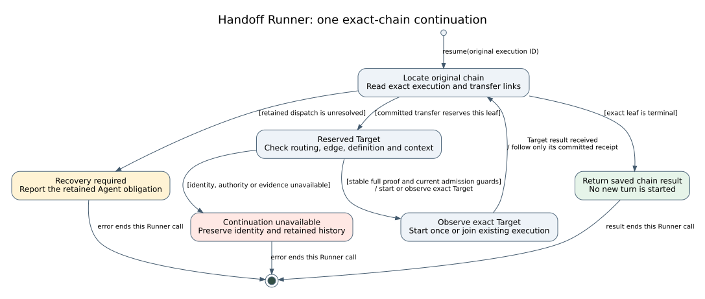

# Handoff dispatch recovery and exact-chain continuation

This directory also contains the focused [initial Target terminal-finalization
submodel](TERMINAL_FINALIZATION.md). The original module below and its 78 cases
remain separately identifiable; the two modules are not a full product proof.

This bounded model separates recovery of one Agent dispatch barrier from the
Handoff Runner's responsibility to finish the same chain. The original Agent
owner preserves the captured save and admits its continuation. The Runner follows
committed Source/Target links. Each caller owns an independent observation.

For example, a Source completes a report Tool, saves the next Provider barrier,
and loses the response and immediate readback. A fresh recovery can confirm that
save. The continued Provider may finish the Source or transfer to a Target. In
both cases, exact Runner re-entry must finish or observe that original chain; it
must not use a new `invoke` to discover whether the old turn completed.

## Scope and model roles

The model checks the Handoff-specific relationship between complete persistence
proof, current routing authority and exact chain identity. The generic dispatch
and shared-attempt protocols remain separately modeled. This is not their full
synchronous product or a refinement proof of the Ruby implementation.

For example, two user turns can use the same Agent under the same Handoff anchor.
A model containing only an Agent ID could accept the wrong turn. This model also
represents the original execution chain and a later unrelated turn.

| Role | Model state | Responsibility |
| --- | --- | --- |
| Original Agent dispatch owner | `owner`, `work`, `durable` | Retain one captured proposal, observe settled storage, explicitly retry only its guarded save, and admit the same continuation once. |
| Handoff routing authority | `route` | Supply the current routing, exact reservation, retention, cancellation and generation facts. |
| Exact Handoff Runner call | `runner`, `chain` | Follow the original chain; admit each exact reserved Target; return an existing terminal result without starting another turn. |
| Recovery callers | `clients` | End their own observations without releasing the worker or durable history. |
| Authoritative read capability | `reads` | State whether complete current proof can be read; transient read loss may be restored. |

The finite bounds are one original retained dispatch, two observer identities,
zero to two committed transfer links, three exact execution identities, and one
later unrelated turn. Recovery read attempts reuse a finite slot and can repeat;
they do not count as new jobs. Exact Target starts are recorded separately from
Agent continuation admission.

## Separate state views

The Agent owner and its caller already have separate abstraction diagrams in the
generic dispatch model. The added Runner view describes another lifetime: one
request to follow an exact Handoff chain. Ending that request does not delete the
chain's history or prove all physical work ended.

For example, an unresolved retained Agent dispatch causes Runner re-entry to
report that recovery is required. The caller can use the existing Agent recovery
capability and later make a fresh Runner call. No implicit barrier retry occurs.

- [Original Agent dispatch owner](../dispatch_preparation_recovery/dispatch-owner.svg)
- [One recovery caller](../dispatch_preparation_recovery/dispatch-client.svg)



The Runner diagram is a UML-style abstraction view with events, guards and
actions. It does not replace the separate generic owner/client diagrams. Its
terminal marker ends a Runner call; the history may remain retained. The model
records a pending recovery report abstractly rather than modeling Ruby exception
classes or the caller's policy code.

## Complete proof and current authority

A historical save fact and permission to start new work are distinct. A read can
confirm the exact captured post-state; a continuation additionally needs the
current domain authority. Explicit retry requires complete pre-state and the same
authority, under the original Store's outer transaction and guard order.

For example, a routing revision or cancellation can change after an earlier
observation. The earlier post-state does not authorize a fresh Provider call.
The model mutations remove individual proof/authority facts and must expose the
resulting invalid continuation or Target admission.

`DispatchFields` abstracts routing revision, active Agent, exact execution
reservation, required same-anchor holds, cancellation and live owner generation.
The complete Agent root/execution/journal/extension footprint is represented by
`durable.barrier`; tests of the Ruby evidence adapter must verify its actual
fields. It is not enough to compare one revision. `held` means the appropriate
same-anchor protection for the current phase: stable turns need not invent a new
execution-specific hold, while a pending/active Target requires the exact
Source and Target holds, including a non-main Source. The one `held` coordinate
abstracts the conjunction of those required holds; the Ruby tests must check
each concrete hold and the Source-inclusive lock/evidence footprint.

Handoff dispatch preserves its captured routing/retention footprint. The generic
Agent evidence owns replay of the saved Agent execution; Handoff replay performs
no participant transaction or routing mutation. `NoDomainReplay` rejects a
mutation that repeats the participant or rebuilds input, and `NoBusinessReplay`
rejects repeating Provider/Tool work to reconstruct proof.

The original and recovery worker must be physically settled before the owner can
admit its continuation. A closed or cancelled observation is not that evidence.
`PhysicalCustody`, `ClosedOriginal`, `IndependentObservers` and `HistoryRetained`
make these responsibilities explicit at this model's abstraction boundary. The
existing dispatch/custody models examine the richer scheduler and admission
knowledge cases; this model does not duplicate or replace that coverage.

## Exact re-entry and guarded Target admission

Exact re-entry follows the saved original execution and its transfer receipts.
It reads a terminal leaf even if the current Handoff routing has moved to an
unrelated turn. Starting a reserved Target requires current authority for that
exact Source/Target transition.

For example, a recovered Source may already have returned its final report. A
second exact re-entry returns that saved report. Calling `invoke` when routing is
stable and no execution is active would instead start a new turn; the
`mutation-invoke-terminal` case makes this unsafe substitution observable.

`TargetFacts` represents the original turn, routing revision and active Agent,
exact pending Target and predecessor, definition, context, current graph edge,
appropriate holds, cancellation, reservation and generation. The Runner reads this complete set before selecting a Target. The existing
reserved-admission operation rechecks only its actual subset: active Agent,
cancellation and, when routing is not stable, the exact pending Target identity.
The model bounds `chain.state = "reserved"` to non-stable routing and represents
that subset in `AdmissionGrant`; it does not enumerate routing phase drift or
invent a fresh full proof inside the operation. The actual conditional pending-ID
check must not be described as an unconditional contract for every phase. A saved selection is not a future admission fence. The stability
premise below therefore also covers the interval from Runner selection to
Target admission. Tests must verify the actual checks at each boundary.

A recovered Agent continuation and a Target admission are different actions.
`NoDuplicateTarget` permits two legitimate successive Targets but rejects a
second start for the same exact target. The bound of two links is a model bound,
not a replacement for the Runner's application policy limit. This model does not
claim an unbounded graph proof or persisted lifetime handoff budget.

## Cancellation and progress premises

Recovery observation cancellation, a request to cancel the Handoff job, and
revocation of routing authority have different effects. Only the latter two can
remove permission to continue job work; none permits fabricating a saved result.

For example, cancelling observer 1 leaves observer 2 and the retained save
available. By contrast, a persisted Handoff cancellation blocks new protected
work. Runner `config[:cancellation_token]` controls job execution; it is not
modeled as an observer-only cancellation token.

`StableAuthority` is the separate existing premise between guarded dispatch
proof and later EventLoop continuation admission, and between a complete Runner
selection read and the later reserved-admission subset check. Neither read is a
durable fence. `missing-authority-stability` deliberately permits dispatch
authority drift and expects `FreshDispatchAuthority` to fail. The separate
`missing-runner-authority-stability` permits context drift after Runner selection
and expects `ExactChainAdmission` to fail because the actual admission subset
does not recheck that context. These results document premises; they are not
fixed implementation defects or proof that arbitrary cross-process mutations
are fenced. The cancellation mutation separately demonstrates why the subset
checks that do exist must not be replaced by a cached Runner grant.

Conditional progress additionally requires a fresh caller, readable complete
proof (or eventual read restoration), settled workers, explicit retry policy for
pre-state, a Runner caller and Target progress. The positive progress cases use
weak fairness for the required protocol actions. Each missing-premise case
removes one premise and expects a temporal violation, except the two authority
stability cases, which expect their named safety violations.

An unresolved/read-failed proof does not become a failure of the logical job.
The owner stays retained. Exact Runner re-entry can report pending recovery but
cannot start a replacement job or turn pre-state into an implicit write.

## Reproduce the checks

The case manifest declares positive properties, deliberate mutations, reachability
witnesses and missing-premise checks. The checker matches the expected diagnostic,
so an intentionally detected violation is not reported as an unexpected failure.

For example, `witness-two-links` asks TLC to violate a negated reachability
predicate. Its counterexample demonstrates the permitted two-link path; it does
not demonstrate a protocol safety defect.

```sh
python3 spec/models/handoff_dispatch_recovery/run_checks.py \
  --module HandoffDispatchRecovery \
  --jar /absolute/path/to/tla2tools-1.7.4.jar \
  --output /absolute/path/outside-the-model-tree
```

The original dispatch module contains 78 configurations: 31 positive properties (26 safety
and five progress cases), 30 deliberate mutations, nine reachability witnesses
and eight missing-premise checks. Consult the produced summary for actual run
results; the case inventory alone is not evidence that TLC was executed.

Use `--case NAME` to select a case and `--java /path/to/java` to choose Java.
The checker verifies the pinned TLC JAR SHA-256, records the actual commands,
model/config/log hashes and state counts, and keeps outputs outside the source
directory. The `cases.json` configurations and companion `.cfg` files are both
complete review inputs; they must agree. The companion DOT file is the source of
the one new SVG; rendering the SVG is separate from executing TLC.

No passing model result establishes Ruby refinement, all thread schedules,
unbounded Handoff graphs, live backend behavior or stop/restart administration.
Actual application tests must exercise the complete error-to-recovery-to-exact-
chain path, including the documented public result and error shapes.
