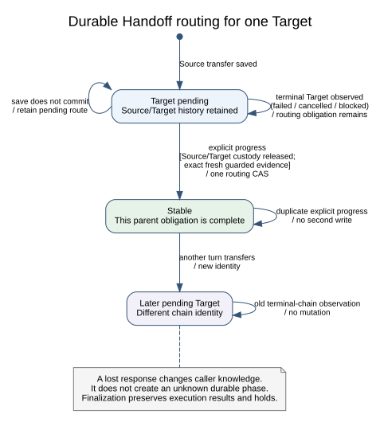
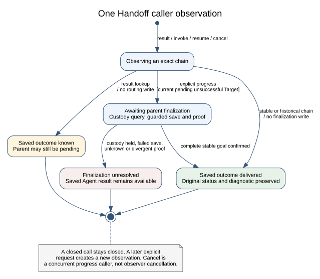

# Initial Target terminal finalization

This focused submodel connects a saved unsuccessful Agent Target with its still
pending Handoff route. It checks the parent-only routing correction, including
local custody, concurrent finalizers, failed save responses and explicit later
requests. The existing dispatch/chain module remains a separate model.

For example, a Target input filter blocks the request before any Provider call.
Agent saves `blocked` and releases its initial mutation custody, but the initial
failure path does not invoke the ordinary Handoff participant. An exact Runner
progress call can then make the pending route stable and preserve that original
blocked result. A read-only result call can observe the block before this parent
transition occurs.

## Bound and separate roles

One Source has already saved a transfer receipt to one exact Target. That Target
has a fixed failed, cancelled or blocked outcome. Two explicit callers can overlap;
the second represents a concurrent cancel finalizer. A new request can reuse a
finite caller slot after an error, while `firstResult` preserves the earlier
observation. Thus progress does not depend on an exhausted fixed number of calls.

| Role | Model state | Responsibility |
| --- | --- | --- |
| Immediate Source and Target Agent custodians | `custody`, `agents` | Release the original execution-mutation responsibility and preserve the saved result. No business code is executed by finalization. |
| Durable Handoff routing | `route`, `bad` | Identify the current pending pair, preserve receipt/reservation/holds, and change only the exact current route to stable. |
| One finalization call | `callers[i]` | Capture domain facts, query both local custodians outside Store guards, reread current guarded facts, attempt at most one save, and close with a result or finalization error. |
| Authoritative save/read environment | `reads`, `faultUsed` | Distinguish actual pre/post outcomes from unavailable caller knowledge. |
| Later legitimate Handoff activity | `advanced` | Move routing to one unrelated chain only after this route became stable. This is not a new turn started by the old finalization call. |

The bounds are one immediate Source/Target pair, one later unrelated chain, two
caller slots, one selected first-save failure, and two finite timestamp values.
Agent custody release is one abstract event per immediate execution, representing
physical settlement and original local mutation-owner release together. The
existing Agent models and Runtime tests examine that internal lifecycle.

This model excludes ordinary successful Target completion, active/suspended
Targets, transfer-following semantics, the full Handoff graph and multiple
independent save failures in one trace. Those are not normalized through this
correction. The source supports only a current `target_pending` Target with
failed/cancelled/blocked status; `target_active` is not silently repaired.

## Entity state views

The Agent and Handoff responsibilities remain separate. Use the existing
[Target initial-owner view](../initial_preparation_recovery/initial-owner.svg)
for the Target's actual initial recovery owner. The
[generic terminal-owner view](../agent_terminal_recovery/owner-state.svg)
is only an abstract Source custody-role correspondence here: Handoff transfer
uses the existing legacy terminal protocol, not a retained native
`OutcomeRecoveryOperation`.





The routing diagram shows actual durable phases. A failed response does not
create an `unknown` routing phase: storage may be pending or stable while a
caller cannot establish which. The client diagram shows one observation's end.
A new explicit request does not reopen its predecessor. Cancel is an independent
job-control/progress caller here, not cancellation of a TaskResult observer.

## Exact snapshot, custody observation and fresh guarded write

`CapturePending` abstracts the first complete domain snapshot under routing and
Agent guards. `QueryCustody` then abstracts both Agent-owned serial observations
outside those guards. `GuardedFinalization` is one atomic domain transaction: it
rereads the complete evidence, recognizes a compatible competing completion, or
performs one exact pending-to-stable CAS.

| Model action or fact | Production correspondence | Limit |
| --- | --- | --- |
| `CapturePending` | `HandoffTerminalFinalization#capture_pending` / `#capture_in` | Exact saved Source/Target semantic evidence and holds are one bounded proof tuple. |
| `QueryCustody` | Internal `Agent#__execution_custody_pending?`, fulfilled by its serial registry observation | Unbound mutation custody is reported held; unavailable, obsolete or foreign authority raises. The query does not wait for an unresolved job to finish. |
| `GuardedFinalization` | `#commit`, `#already_finalized?`, `#save_routing` | First snapshot and fresh proof must agree; a concurrent stable goal has exactly the permitted routing change and unchanged non-routing evidence. |
| `ReadBack` | `#reconcile_save` and `Persistence::SaveOutcome` | Complete exact pre/post evidence; unreadable or divergent evidence is not confirmation. |
| `agents.outcome` | Saved failed/cancelled/blocked execution result and diagnostic | Routing errors never replace the Agent's logical result. |
| `firstResult` and current caller phase | Independent original and later explicit requests | A later request is not success delivered to the old failed observation. |

`bad` ranges over grouped anchor/Store and Source/Target identity, receipt/context,
terminal-status/result, active-execution and main/Source/Target hold mismatches.
The grouped authority property includes changes after custody was queried, so a
previous valid snapshot cannot replace the fresh guarded check. These coordinates
abstract semantic mismatches; Ruby tests must verify every concrete field and
ordered guard set, including a non-main Source. Hold evidence is restricted to
this Handoff owner key; unrelated domains' retention changes are not part of the
finalization proof and cannot invalidate it.

The source checks live incarnation and Runtime availability in C04. The model
abstracts their result into query identity and held/released custody. It does not
prove EventLoop queue mechanics, mutex ordering, lock freedom or deadlock absence.
In particular, normal initial waiter publication before registry release is a
Runtime correspondence test; the model's serial query is the resulting atomic
ownership observation, not a simulation of each Ruby instruction.

## Exact post-values are not causal writer identities

The intended routing post-state includes a generated timestamp and revision.
`stamps` is a finite nondeterministic map of timestamp values, so concurrent
proposals can be identical or different. No unique production attempt token or
writer identity is assumed.

For example, caller A's save fails before committing and caller B subsequently
saves the stable route. If both intended post-values are identical, A's readback
may confirm that exact postcondition. If their timestamp values differ, A's
failed-save proof remains unconfirmed, although a new call may observe the
already stable route without writing. Confirmation establishes the captured
post-state, not which caller caused it.

`CompatibleStable` separately represents a competing finalizer's permitted goal
at the fresh guarded transaction: revision increases by one, phase becomes stable,
and all other routing/non-routing facts remain compatible. `ExactPost` is stricter
for failed-save classification and compares the entire intended routing value.
`lastCommitter` and `competingExactPost` are ghost coverage markers for the
concurrency witness only. Neither authorizes a write or confirmation.

## Safety, progress and premises

The material safety checks require both original Agent custodians to be released,
query identity to match, exact current chain authority, unchanged outcome, no
business replay, one effective finalization write and complete confirmation.
Each explicit request attempts at most one save. The current Caller result may
be a finalization error while the original saved Agent failure remains readable.

`HistoryRetained` and `ResultReadOnly` are structural checks in this module:
finalization has no action that deletes holds/history, and the observation action
has no routing write. They identify the modeled responsibility boundary; they
are not backend, administrative-race or Ruby refinement proofs. Concrete tests
must verify the actual code respects that boundary.

Local custody is queried outside Store guards and before the final write
transaction, after the first guarded capture has completed. Its useful stability
premise is
that a valid exact terminal execution cannot reacquire business-mutation custody
after its original custody was released. `missing-terminal-monotonicity` removes
that premise and must expose `CustodyBeforeFinalization` violated. This is not a
claim that no queued duplicate observer or unrelated future operation exists.
The same-transaction domain proof and write need no separate dispatch-style
proof-to-admission stability premise. Configured transaction/CAS correctness and
truthful authoritative storage remain underlying assumptions.

Positive progress additionally requires fresh explicit requests, eventual release
of both immediate original custodians, valid cleanup evidence, available or
restored reads and completion of the synchronous transaction/readback. Weak
fairness applies only to those enabled protocol actions. Missing fresh-request,
custody-release and readable-proof settings expect temporal counterexamples.
A completed finalization observation may still deliver the saved business error;
it is not a successful business result.

The immediate Source/Target queries do not prove that all older Handoff owners
have released custody. History removal and Agent unload acceptance are limited
to the covered settled chain. Normal transfer delivery releases its Source
before the ordinary Runner drives its successor, but independent reentry can
observe durable transfer history before older local delivery finishes. Broader
all-history custody/release correspondence remains outside this model and open
under U01. Finalization itself never deletes history or unloads an Agent.

Architecture remains C01 MultiAgent/Handoff for domain decisions, C04 Agent for
local custody, and C07 neutral Persistence/SaveOutcome for transaction mechanics.
The model introduces no new manager and no reversal of those dependencies.

## Configuration inventory and execution

The focused module has 33 configurations: 12 positive property settings,
13 deliberate mutations, four missing-premise settings and four reachability
witnesses. It adds one mutation beyond the planned 32 to distinguish incomplete
post-payload acceptance from accepting another caller's different post-value.
Both are needed to test the complete proof boundary.

The concurrent positive case combines a first pre-write failure with a competing
winner and explores coincident and distinct timestamp assignments. The concurrent
witness requires both callers to have checked the pending route, one effective
write, and exact post-value confirmation after the other caller's write; a purely
sequential stable observation cannot satisfy it. The missing-fresh-request case
starts with custody already released, isolating the absent explicit retry. The
restored-read positive setting loses proof reads after the selected post-save
response failure, then permits restoration before readback or a later request.

The original dispatch module retains its 78 inputs: 31 property, 30 mutation,
eight missing-premise and nine witness settings. The combined family inventory
is 111 settings: 43 property, 43 mutation, 12 missing-premise and 13 witness.
The family count is unchanged; these modules are not a full synchronous product.

```sh
python spec/models/handoff_dispatch_recovery/run_checks.py \
  --module HandoffTerminalFinalization \
  --jar /path/to/tla2tools-1.7.4.jar \
  --output /path/outside/repository/finalization-evidence
```

Render the standalone DOT views with `render_finalization_diagrams.py --receipt`
and an external JSON path. It runs Graphviz, prefixes every SVG ID/reference with
`htf-routing-` or `htf-client-`, and records source/raw/rendered hashes and commands.
The two views can therefore be embedded alongside existing diagrams without
Graphviz default ID collisions. Their rendering is separate from TLC execution.

The runner verifies companion configurations, records each case's module and
model hash, and stores raw logs/configurations externally. Mutations and witnesses
must produce their named invariant counterexample. Missing-premise cases expect
a temporal counterexample except terminal-custody monotonicity, which expects its
named safety violation. Inventory counts alone are not execution evidence; consult
the bound result receipt. No full-family rerun or full implementation proof is
implied by a focused-module run.
