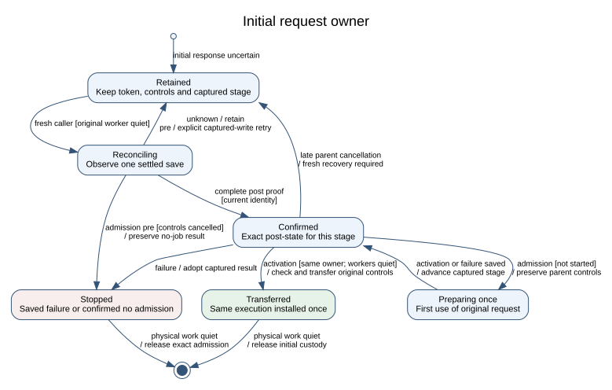
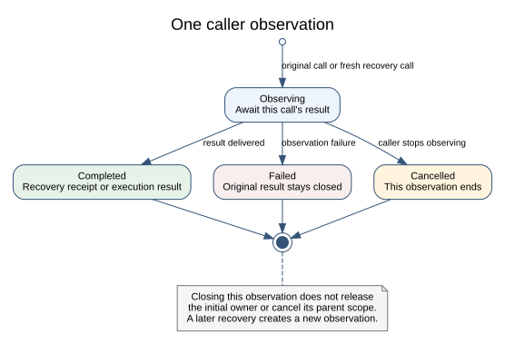

# Initial preparation recovery

This bounded model checks the owner of an initial Agent request before a live
execution session exists. It keeps the original admission token, captured save
and parent controls alive after the first caller's observation fails. A fresh
caller can establish the save outcome and continue that same request once.

For example, the first manifest save commits but its response is lost. The
Provider has not run. Recovery must adopt that exact active execution without
calling the filters, hook or Policy again. If the parent was cancelled while the
caller was no longer observing, the retained controls must still prevent a new
Provider admission.

## Roles and finite bound

The owner, save facts, physical workers and caller observations have separate
state. Their lifetimes meet at explicit proof, completion and transfer events.
The end of the initial owner is not the end of the logical execution.

| Role | Model state | One-level responsibility |
| --- | --- | --- |
| Initial request owner | `owner`, `metrics` | Keep the exact request, original token, stage and controls; consume complete facts once; transfer or release custody. |
| Captured save | `durable` | Describe the complete pre-state, post-state or divergent footprint for one admission, activation or failure save. |
| Physical recovery attempt | `work` | Settle the original worker, classify or explicitly retry the captured save, and deliver stage-qualified facts. |
| Original and recovery callers | `clients` | Observe results independently; closing an observation does not release the owner or reopen an earlier result. |
| Store and domain authority | `authority`, `reads` | Provide exact identity, current guarded permission and readable authoritative save facts. |

The finite bound is one original owner/token and execution, one original caller,
two recovery observer identities, and **one uncertain save**, selected by
`Boundary`. Later preparation stages complete normally in this model. Recovery
reads can repeat through a finite attempt slot. A first submission may be
positively refused or have unknown admission knowledge; the latter never permits
a second overlapping submission.

This is not a model of simultaneous response losses at several stages, arbitrary
application admission callbacks, every Handoff routing field, or the whole Agent
job. `providerCalls` marks the first permitted business admission at the handoff
boundary; it does not simulate Provider completion or prove its external effects.
It is not a synchronous product of the existing models or a refinement proof of
Ruby code.

## Separate state views

The owner diagram follows custody and continuation. The client diagram follows
one observation. A fresh recovery call creates another observation; it cannot
change an already failed original task or reattach its listeners.





These are UML-style abstraction views, with event, guard and action labels. The
owner's final marker ends its initial custody after transfer or confirmed failure.
The caller's final marker ends only that observation. A parent-scope cancellation
is a job control event represented separately by `CancelParent`.

## Three save boundaries

The model does not flatten every saved post-state into permission to install a
session. The captured stage determines what can happen next.

| Captured stage | Post-state permits | Pre-state permits |
| --- | --- | --- |
| `admission` | First use of the still-unrun preparation, or cancellation handling under the original controls. | Explicit guarded retry, or release without a durable job when the original controls were cancelled. |
| `activation` | Install the same execution once, or capture a cancellation failure before business admission. | Explicit retry of the captured activation, or a cancellation save from the exact preparing pre-state. |
| `failure` | Adopt the original saved failure and release the exact original admission. | Explicit retry of the captured terminal records; no repeated failed preparation. |

`BeginPreparation` runs inside the recovery worker after admission proof and
sets the retained first-use fact before increasing the preparation count. `CompletePreparation` advances to a captured activation or
failure stage. That bounded transition abstracts normal construction and saving
of the next proposal; it does not claim recovery of an incomplete proposal or a
second uncertain save. Reconciliation does not retry the uncertain save, but a confirmed admission may
authorize first-time preparation and its next save. A materialization failure
after confirmed activation has
the same once-only terminal-save obligation, but its internal computation is not
separately enumerated here.

`NoPreparationReplay`, `OneInstallation`, `ExactStageProof` and `NoProposalReplay`
reject repeated preparation, duplicate installation, wrong-stage evidence and
proposal/participant replay. `ExactRetry` requires a complete current pre-state
and guarded captured writes. Unknown or divergent facts retain custody. Complete admission pre-proof and
captured cancellation permit `StopWithoutAdmission`: it releases the original
runtime slot without creating a durable job or invoking preparation. Activation
pre-proof under cancellation instead permits `StopBeforeActivation`, which saves
cancellation from the exact preparing execution. Neither branch retries the
unwanted business transition.

## Historical facts, current permission and parent controls

A saved transition and permission to continue are different facts. The model
records historical save classification in `owner.fact`, and permission observed
with that proof in `owner.grant`. A later cancellation cannot turn an already
saved transition into an unsaved one.

For example, a failure save can be confirmed after its parent no longer permits
business dispatch. The saved failure must still be adopted and the original
admission released. Terminal adoption and explicit retry of a captured failure require cleanup
authority for the original identity, not a fresh permission to call the Provider.
Later parent cancellation must not replace an already captured business failure
with a regenerated cancellation proposal.

`durable.state` abstracts the complete captured root, execution, active-execution
set, journal suffix/head and content bytes. Ruby tests must check the concrete
records; this model does not enumerate each field. `IdentityGrant` represents the
original owner incarnation, Store identity, exact reservation and admission token.
`ProofGrant` adds the domain facts captured at proof time. `OwnerContinuationGrant`
represents the later exact runtime-owner gate. It is not a fresh reread of the
full captured domain footprint. Parent controls are separately checked again.

For framework Handoff admission, `ReservedChildAdmission::InitialAuthority`
reuses the active-Agent, cancellation and conditional pending-Target validator,
and additionally captures and compares the Handoff routing record and retained
references of the involved Agents. Those current checks run inside the evidence
transaction. The later EventLoop application rechecks the retained runtime owner
and parent controls; it does not reread that full domain footprint. `freshGuard`
and `capturedDomain` abstract the proof-time guard and captured footprint. This
family does not enumerate their concrete routing, context and hold values or
prove the full Handoff authority contract.

`StableAuthority` excludes changes to un-rechecked domain facts while a worker's
proof is recorded, the owner is confirmed, or first-time preparation is in
progress. It is an explicit environment premise, not a fence supplied by a Store
read. `missing-authority-stability.cfg` deliberately removes that premise and
must find `CurrentAuthority` violated. Changes before proof are allowed and block
new continuation. Historical terminal adoption remains possible when only the
current dispatch guard changes.

Parent cancellation is not hidden inside that stability premise. `CancelParent`
can occur after `OriginalFails` and before transfer. `controlsHeld` means the
original scope remains connected to its initial owner until responsibility is
transferred or terminally released. `OriginalControls` rejects the mutation that
closes those controls with the old observation and later admits business work.
This supported control behavior must be implemented, not assumed. If cancellation
arrives after the worker produced an active result but before EventLoop
installation, `AdoptActivation` retains the activation stage. A fresh recovery
then runs `StopAfterProof` and captures the cancellation save. The model does not
invent a terminal write on the EventLoop thread. A control error captured before
proof can choose cleanup even if new dispatch is forbidden. If a non-cancellation
domain rejection has already prevented continuation, cancellation arriving only
after that captured check needs a fresh attempt; `CanStopAfterProof` preserves
that ordering.

## Physical custody and submission knowledge

An observer's failure does not prove that its worker stopped. The original physical attempt must settle before a recovery attempt begins.
First-time preparation after admission proof runs inside that recovery worker;
it does not wait for its own future physical completion. The recovery worker
then settles before the EventLoop can install a session or release custody. The retained owner independently blocks replacement
or unload after ordinary observation leases have ended.

`PhysicalCustody`, `RetainedCustody`, `ClosedOriginal` and `IndependentObservers`
check these distinctions. `SubmissionKnowledge` detects resubmission from unknown
admission. The `Submission` setting applies to a recovery attempt in this model:
initial worker refusal before any save exists remains covered by the shared
submission/custody protocol and concrete Runtime acceptance tests. A positive
recovery-submission refusal does not release the original uncertain save owner.

The model's D2 completion is stronger than returning a historical failed result:
`EventuallyReleased` also requires release of the original admission. Returning a
saved failure while leaving the original runtime slot busy does not satisfy it.

## Source correspondence

The model abstracts the production methods below. This mapping identifies the
source boundaries; it does not establish executable refinement.

| Model boundary | Source boundary | Limit |
| --- | --- | --- |
| Original owner and token custody | `InitialPreparationRecoveryOperation`, `ExecutionRegistry` initial-owner retention and matching-token resolution | One owner incarnation; process loss and migration are not modeled. |
| Captured save classification and retry | `InitialPersistenceEvidence#reconcile` / `#retry` | Complete footprint and content comparison is one abstract fact. |
| First-time preparation and subsequent result | `InitialPreparationRecoveryOperation#recover_checkpoint`, `InitialPreparation#continue` / `#stop` | The continuation runs inside the recovery worker; one uncertain save per trace. |
| Session installation or terminal adoption | `ExecutionCoordinator#apply_retained_initial_preparation_on_event_loop` | Requires physical completion, exact owner and original controls; no invented full domain reread. |
| Parent controls across a failed caller | `InvocationControls` retained by the original owner and transferred on resolution | Cancellation is interleaved at modeled action boundaries; internal instruction-level races are not enumerated. |
| Framework reservation proof | `ReservedChildAdmission::InitialAuthority` | Current transaction proof is distinct from the later EventLoop gate. |

The legacy `InitialPreparation#recover` replay-safe reload path is outside this
family. It does not inherit a proof merely because it shares preparation helpers.

## Existing model relationships

Existing model families retain their own bounds and are reused as protocol
references, without inheriting a combined proof claim.

| Existing family | Reused obligation | Added initial-owner distinction |
| --- | --- | --- |
| `recovery_submission_custody` | Attempt admission knowledge, physical settlement and retained result custody. | The original request may not yet have an installed session or caller-known execution identity. |
| `agent_terminal_submission` | Known refusal differs from unknown admission; logical observation is separate from physical execution. | Initial custody owns the original admission token across that uncertainty. |
| `dispatch_preparation_recovery` | Captured pre/post evidence, explicit guarded write retry and no business replay. | Admission post-state can authorize first-time preparation; activation/failure post-state has different continuations. |
| `handoff_dispatch_recovery` | Historical proof differs from current domain authority; exact chain identity remains significant. | This model does not repeat or claim the Handoff exact-chain continuation product. |

## Running and reading the checks

`cases.json` is the case manifest. Each case has a companion `.cfg` with identical
configuration text, verified by `run_checks.py`. Use the pinned TLA+ tools 1.7.4 JAR with
SHA-256 `936a262061c914694dfd669a543be24573c45d5aa0ff20a8b96b23d01e050e88`.

```sh
python spec/models/initial_preparation_recovery/run_checks.py \
  --jar /path/to/tla2tools-1.7.4.jar \
  --output /path/outside/repository/model-evidence
```

The manifest contains 42 settings: 18 positive property configurations, 15
intentional mutations, five reachability witnesses and four missing-premise
configurations. Positive progress cases check safety and `EventuallyReleased`.
Mutations must violate their named invariant. Witnesses negate a reachable state
and must produce the named counterexample; their failure is expected evidence of
reachability. Three missing-premise cases expect a temporal counterexample, while
the missing authority-stability case expects `CurrentAuthority` to fail.

Progress requires a fresh caller, readable or eventually restored proof,
authoritative settled storage, original owner availability, physical settlement,
result delivery, supported fresh guards and fairness of the explicit actions.
A complete pre-state needs explicit captured-write retry unless the supported
D0/D1 control-stop branch resolves it without writing that original proposal. These
are conditional progress results; unconditional distributed liveness is not
claimed. Raw TLC logs, configurations, source hashes and tool identity belong in
the external evidence directory produced by the runner.
