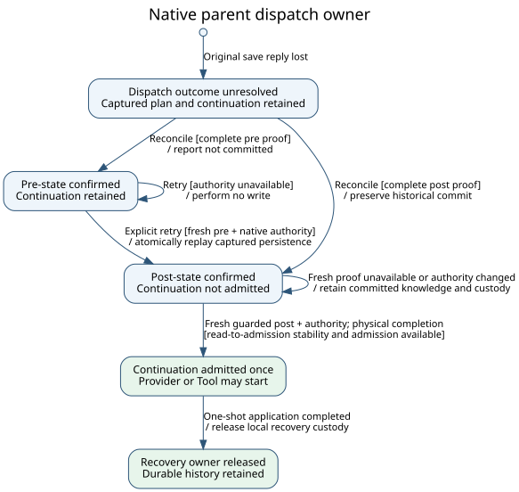
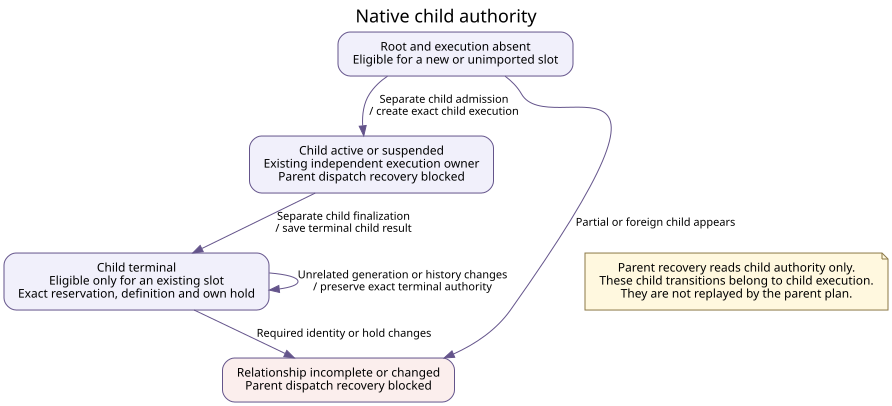
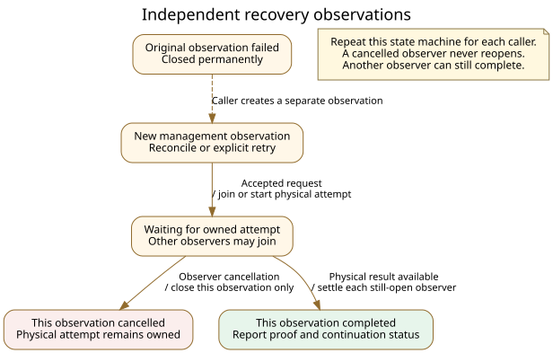

# Native parent dispatch recovery model

A native parent coordinates child relationships while Agent owns dispatch persistence and its one-shot continuation. Recovery must prove the captured parent write and independently validate current native child authority. The detached domain plan restores only captured persistence; it does not repeat coordination policy, preparation, or external work.

For example, a report parent reserves a reviewer and then loses the reply from its Tool dispatch save. A later management observation can prove that the parent extension and its own history retention committed. The parent still cannot start the captured Tool continuation if the formerly absent reviewer identity has appeared in the meantime.

The baseline is applied G3f `56e0e5bfedc5715749d9f10d1ddab11654d02db2`. Contract concept v55 and foundation v48 remain the architecture references. This is a finite protocol model of G3g, not a refinement proof of Ruby or a general participant recovery protocol. Existing public `reconcile_dispatch` and `retry_dispatch` operations are reused; no application API is invented by this model.

## Separate the three state owners

Parent persistence knowledge, child execution authority and client observation have independent state transitions. A confirmed parent write can coexist with a blocked continuation and a cancelled observer. Those facts do not require changing the child's durable result or reopening a failed observation.

For example, one caller cancels its recovery observation while the physical save is still running. A second caller can later receive the same attempt's result. The parent owner retains the physical attempt throughout, and an exact terminal reviewer remains in the child's existing execution domain.







These are separate UML-style state views with events, guards and actions on their arrows. The child diagram includes contextual child admission and finalization transitions owned by child execution; the finite recovery model selects the initial child category and relevant authority changes. Parent recovery never performs those child transitions. The dashed client arrow creates a separate observation; it does not reopen the original failed one.

| Model element | Implementation meaning |
| --- | --- |
| `Before`, `After`, `ObservedParent` | Complete Agent evidence: root, execution, journal, decoded execution extension and cancellation ledger, plus the native parent retention set. |
| `durable.blob` | Exact captured opaque extension content and its validated content identity. |
| `ChildKind` | Newly reserved slot, existing unimported slot, or existing imported slot in the captured native plan. |
| `child.reservation`, `child.definition`, `child.hold` | Exact child reservation correlation, definition identity/version, and required native history retention. |
| `child.generation` | An unrelated changing child fact that is not frozen into parent historical proof. |
| `GuardedTransaction` | Fresh parent classification and native authority checks in the recovery transaction; an explicit eligible pre retry restores captured persistence atomically. |
| `owner.known`, `owner.everPost` | Historical parent persistence knowledge, retained after committed evidence has been seen. |
| `work.grant`, `owner.fresh` | Separate fresh authority for the still-unused continuation; a native continuation error leaves these false. |
| `originalPhysical`, `work.physical` | Physical completion of the original save and recovery attempt. |
| `clients.status` | Independent recovery observations; the original invocation is already closed with failure in this selected profile. |

The new-slot profile adds the parent's own retention. Existing-slot profiles already hold it, so retry adds nothing. The captured execution and extension change, while the selected original dispatch leaves root, journal and cancellation coordinates unchanged. They remain part of the complete proof and cannot be ignored if a later writer changes them.

## Prove persistence before admitting continuation

The parent write footprint determines whether the exact captured change is pre-state, post-state or unresolved. Native child authority is an additional condition for a pre-state retry or a still-unused post-state continuation. Failed authority does not erase a historical committed parent write.

For example, a terminal reviewer with the exact reservation, definition and native hold permits recovery of an existing parent slot. Removing that required hold blocks continuation while preserving confirmed post-state knowledge. A change to an unrelated child generation does not revoke the same terminal relationship.

| Captured slot category | Fresh eligible child state |
| --- | --- |
| Newly reserved | Both child root and exact child execution absent. |
| Existing, unimported | Both absent, or exact terminal child with matching definition, reservation and required hold. |
| Existing, imported | Exact terminal child with matching definition, reservation and required hold. |
| Existing active or suspended child | Recovery is blocked in this increment. |
| Partial presence, changed reservation/definition, or missing required hold | Recovery is blocked. |

`Fact` compares all six parent coordinates, including decoded extension content. `ExactRetry` records that every recovery write started from a fresh complete pre-state, current eligible child authority and the original owner, then restored the complete captured post-state. The detached replay action writes no child records. Its content and retention changes occur in the same abstract atomic action as the captured execution save.

The production plan additionally validates immutable Store identity, the original content reference and canonical bytes, append-only child slot identity and the allowed own-parent retention delta. These are capture and storage-conformance preconditions, not separate value-level encoders implemented in TLA+. Ruby tests remain responsible for real JSON, SHA-256 references, record revisions and rejection of malformed detached plans.

The selected terminal-child abstraction relies on the existing immutability of exact terminal execution history. Recovery checks current identity, terminality and the required hold; it does not compare or rewrite every terminal result byte. Unrelated child cancellation intent or retention generation changes are not frozen into the parent commit proof.

`HistoricalPostSticky` keeps committed knowledge even when a later read is unavailable or changed. `FreshNativeAuthority` and `CompleteParentProof` validate the eventual admission separately. A failed fresh proof keeps pending continuation custody; it neither repeats a known committed write nor grants admission from cached historical knowledge.

## State the concurrency and progress premises

Guarded transactions protect their own reads and writes. Eventual continuation additionally needs a caller, readable storage, physical completion and an available admission path. A guarded read does not create a durable fence against an arbitrary conflicting writer after the transaction returns.

For example, if a child root appears after the recovery transaction proved it absent but before the owner admits continuation, the earlier absence proof alone cannot rule out conflict. Removing the read-to-admission stability premise produces an expected safety counterexample in this model. A cancelled observer does not supply that missing premise or terminate the physical owner.

The implementation orders guards for the parent and existing child roots; the Store cannot guard an absent root. New-child root and execution absence are checked inside the same transaction. Neither that absence check nor original local owner custody is a distributed reservation of an absent child identity. `StableRead` therefore explicitly excludes conflicting authority or parent-proof mutation between the guarded result and owner-thread admission. Transaction isolation and the absence of unauthorized competing writers remain concrete Store and integration obligations.

`ProgressSpec` adds weak fairness only to enabled completion, management attempt, guarded transaction, result delivery, admission and release actions. `Caller`, `ExplicitRetry`, `Readable`, `Cleanup` and `Admission` state the corresponding environmental premises. A missing explicit retry cannot turn a confirmed pre-state into a post-state by observation alone. A lost retry response can require the third and final modeled read, which confirms the write without repeating it.

`RefuseFirst` represents an initial unavailable local continuation admission. The owner retains its confirmed post-state and performs another fresh native proof before later admission. Child and parent authority changes can occur before that proof. `ObserveClients` enables two independent observers and cancellation interleavings; physical attempt ownership is retained even if both observers cancel.

The model bounds one captured parent dispatch, one representative native child relationship, three management attempts, two observers and one relevant external change. Provider and Tool share this detached persistence/admission protocol; transport behavior and business-result processing are exercised by the runtime tests rather than duplicated as meaningless model constants.

## Check positive rules and deliberate counterexamples

The case matrix separates valid safety/progress checks from deliberately broken rules, reachable-state witnesses and missing premises. Negative checks are successful only when TLC reports the specified counterexample class; they do not leave a known production invariant violation unresolved.

For example, the cached-post mutation starts with confirmed parent persistence, changes child authority, and incorrectly admits the continuation from cached knowledge. Its named safety invariant fails. The correct protocol reaches the separate confirmed-post-but-blocked witness while retaining custody.

| Case family | Count | Expected result |
| --- | ---: | --- |
| Safety configurations | 24 | All selected invariants hold. |
| Progress configurations | 5 | Explicitly conditioned one-shot admission and local recovery release hold. |
| Safety mutations | 27 | The named invariant has a counterexample. |
| Progress mutation | 1 | Freezing an irrelevant child generation blocks otherwise valid recovery. |
| Reachability witnesses | 6 | The negated valid-state invariant has a counterexample. |
| Missing progress premises | 5 | The admission property has a temporal counterexample. |
| Missing read-to-admission stability | 1 | Current-authority safety has a counterexample. |

The safety rules cover complete parent proof, captured-only retry, separate child authority, sticky committed knowledge, no child writes, no preparation/participant/effect replay, durable history retention, physical custody, closed original observations and one-shot admission. Mutation cases omit each parent proof coordinate, reuse cached pre/post facts, omit content or hold restoration, ignore child identity/hold checks, write child state, repeat business work or release ownership on observer cancellation.

Each configuration is stored verbatim in `cases.json`. The runner materializes it beside the copied model outside the source directory. Parser errors, runtime errors, a wrong invariant, an unexpected successful negative case or an unexpected positive counterexample fail verification.

## Reproduce the finite checks

The runner pins the model-checking tool and records source, configuration and output hashes. Generated state databases and logs remain outside the repository model directory so the source package stays inspectable and reproducible.

For example, the following commands run the complete case matrix and regenerate the three separate diagrams:

```sh
python3 spec/models/native_parent_dispatch_recovery/run_checks.py \
  --jar /absolute/path/to/tla2tools-1.7.4.jar \
  --output /absolute/path/outside-the-model-source

dot -Tsvg spec/models/native_parent_dispatch_recovery/parent-owner.dot \
  -o spec/models/native_parent_dispatch_recovery/parent-owner.svg
dot -Tsvg spec/models/native_parent_dispatch_recovery/child-owner.dot \
  -o spec/models/native_parent_dispatch_recovery/child-owner.svg
dot -Tsvg spec/models/native_parent_dispatch_recovery/client-observer.dot \
  -o spec/models/native_parent_dispatch_recovery/client-observer.svg
```

The pinned TLC JAR SHA-256 is `936a262061c914694dfd669a543be24573c45d5aa0ff20a8b96b23d01e050e88`. Capture validation, content encoding, ordered guard implementation, transaction isolation, actual worker cancellation, private capability wiring and integration with Provider/Tool adapters require Ruby and application acceptance evidence.

Native terminal persistence, including a terminal committer that actually returns a nonterminal coordination wait, remains outside G3g. Approval-decision recovery, Handoff routing lineage, arbitrary participant replay, process-loss recovery, multiple-child interleavings and a general distributed fencing protocol are also outside this finite model. No result here closes those separate residuals.
