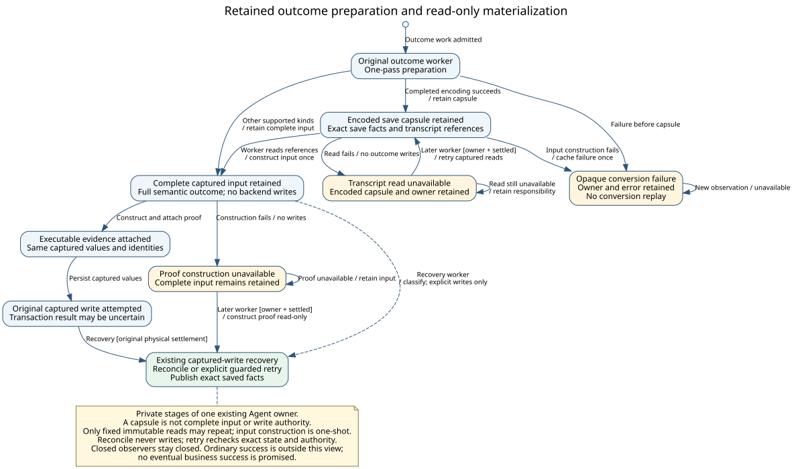
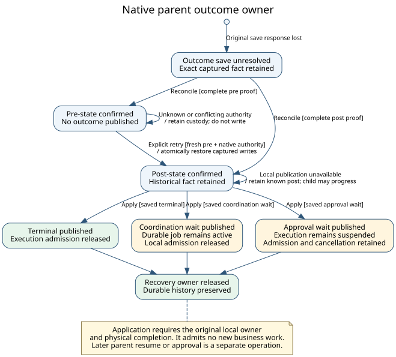
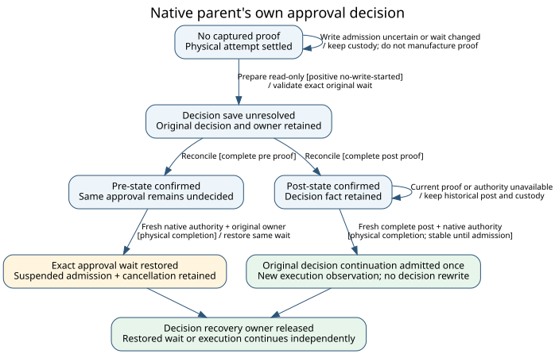
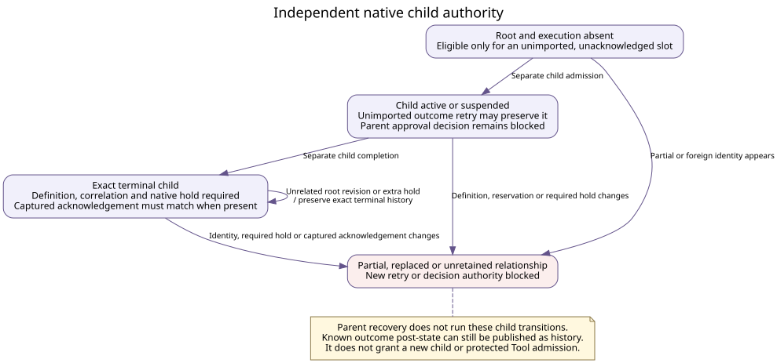
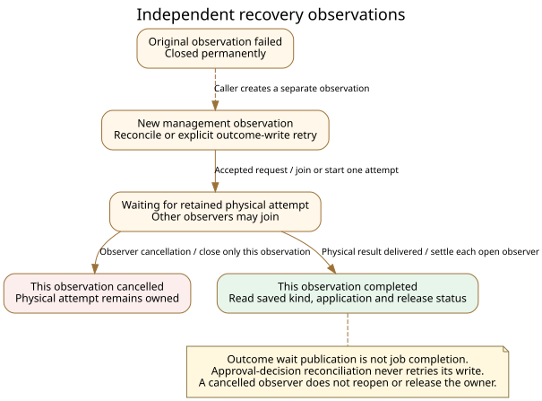

# Native parent outcome and approval recovery model

A native parent can save a final result, an active coordination wait or its own suspended approval wait. Recovery must preserve the actual saved kind while keeping persistence knowledge, recovery ownership, execution admission and client observation separate. Recovery of the parent's own approval decision has a different rule: it reads the original decision's outcome and never repeats that decision write.

For example, a report parent tries to finish while a reviewer still owns work. Its participant saves a coordination wait. Proving that save committed permits publication of the same active wait; it does not prove that the report completed. If the reviewer finishes meanwhile, a later ordinary parent resume can import that new fact.

The original G3h model used applied G3g `44288e1239701bf16aa67854a48c830b7295e2d4`, tree `31193090f7305c82da780765f803b955742330c7`, as its baseline. The G3i preparation prefix extends applied G3h `cfef5fc0b961e8e29868e0fa15b03326dc1d7629`. Contract concept v55 and foundation v48 remain the architecture references. This is one bounded protocol model, not a refinement proof of Ruby. The public native `OutcomeRecovery` family distinguishes these three saved kinds; the existing `TerminalRecovery` family remains actual-final-only. The parent's own decision uses the existing `ApprovalRecovery` family.

## Retain complete material before real outcome writes

The original worker constructs a complete detached persistence proposal, retains its raw values, and attaches executable evidence before admitting any real outcome write. Complete raw material and an executable proof object are separate milestones. The new prefix joins the captured-write protocol below; it does not introduce another durable job or a central owner for the other entities.

For example, writing a captured approval-wait content value can fail after backend admission. The proposal already includes the exact request, generated record identities, timestamps, Agent values and native extension/retention effects. Later recovery can replay those captured writes without rerunning the encoder, output validation, participant commit, Provider or Tool.



This recovery view assumes that the original observation failed or ended before physical settlement, as represented by `clients.original = "failed"` in `Init`. Ordinary first-save success follows normal publication outside this view; the diagram does not require every successful write to enter recovery.

`PreparationMode = "staged"` enables the original-worker prefix. `PrepareOriginal` either retains complete raw material or enters an opaque preparation failure. `ConstructOriginalProof` attaches evidence, or preserves complete raw material with no admitted outcome write. `OriginalWrite` follows only after evidence attachment. Its atomic result is abstracted as the complete before- or after-state; concrete per-write rollback behavior remains a Store and Ruby-test obligation. The prefix uses the same guarded transaction premise as the original native preparation; conflicting parent/child changes are modeled after that scope, not between its staging steps. This is not a new distributed fence for absent child roots.

The original 99 configurations use `PreparationMode = "legacy"` and preserve their former initial scenarios, properties and expected outcomes. Added constants explicitly select the old initial boundary rather than retroactively claiming the old runs covered staging. In particular, the old uncaptured-outcome cases still mean no complete raw proposal, even when the old backend state happens to be post-state.

## Materialize evidence without repeating preparation

After the original physical work settles, a management attempt may construct executable evidence from the same complete retained raw values. This construction is read-only. An explicit retry may then classify current persistence and write the captured proposal in the same management attempt; those writes belong to retry, not proof construction.

For example, the first `NativeOutcomeEvidence` construction can fail after complete raw capture and before any real write. A later reconciliation can construct the evidence and confirm pre-state; a later explicit retry can save it. Alternatively, the first explicit retry can materialize, classify and write. A genuine encoder or custom conversion failure before complete capture remains held and unavailable, because no replay contract permits repeating that opaque work.

`Materializable` is the explicit availability premise for later proof construction. `InitialProofFails` selects an original construction failure, while `ImmediateRetry` includes a caller who starts with explicit retry rather than a read-only reconciliation. `CompletePlanBeforeWrite`, `RawPlanIdentity`, `ReadOnlyMaterialization`, `SettledMaterialization` and `NoOpaquePreparationReplay` check ordering, identity, no construction writes, physical/owner authority and the lack of generic preparation replay. `OpaquePreparationRetained` checks the intentionally blocked case. No property promises that an arbitrary incomplete encoder or conversion will eventually succeed.

## Separate the owners and their events

The parent owns its saved facts and local recovery operations. The child owns its independent execution. Each client owns its observation. Publishing a wait can resolve one recovery owner while leaving the logical parent execution active or suspended.

For example, one caller cancels its reconciliation observation while a physical read continues. A second caller can receive the result. After a saved approval wait is published, the recovery entry can be removed while the original suspended execution admission and its cancellation binding remain live.









These are separate UML-style state views with events, guards and actions. The two parent views describe different operation protocols within the same parent domain, not two independent durable jobs. The child view includes contextual admission and completion transitions owned by the child; parent recovery never runs them. The dashed client arrow creates a new observation rather than reopening the original failed one.

| Model element | Implementation meaning |
| --- | --- |
| `Kind` | Captured actual final outcome, coordination wait, own approval-wait save, or own approval decision. |
| `Before`, `After`, `durable.row` | Complete Agent evidence: root, execution, journal, decoded native extension, cancellation ledger and parent retention set. |
| `durable.agentBlob`, `durable.nativeBlob` | Exact captured Agent content and native extension bytes, including validated content identity. |
| `child.reservation`, `child.definition`, `child.hold` | Exact deterministic child relationship, definition identity/version and required native retention. |
| `child.outcome`, `child.generation` | Captured terminal acknowledgement fingerprint when present; a separate unrelated changing child fact. |
| `owner.known`, `owner.everPost` | Historical persistence knowledge, retained after the exact post-state is confirmed. |
| `owner.held`, `owner.executionAdmitted` | Distinct save-recovery ownership and logical execution admission. |
| `originalPhysical`, `work.physical` | Physical settlement of the original save and a subsequent management attempt. |
| `clients.status` | Two independent recovery observations; the selected original invocation is already closed with failure. |

The model abstracts immutable values and record revisions as matching or changed coordinates. Actual Store identity, JSON encodings, canonical references, deterministic slot hashes, approval request contents and append-only native plan validation remain Ruby test obligations.

## Preserve the saved outcome and its lifetime

The captured write footprint determines which exact fact can be published. A terminal-intent call that actually saved a wait must keep that wait's semantics. A confirmed pre-state permits only an explicitly requested replay of already captured persistence writes.

For example, an own approval-wait save contains the same approval request and suspended execution after recovery. Publishing it cannot execute the protected Tool or expose a terminal execution receipt. The application later submits approval as a separate operation.

| Saved kind | Abstract write shape | Local application and receipt |
| --- | --- | --- |
| `terminal` | Root, execution, terminal journal, Agent content, native extension and allowed parent hold delta. | Publish the exact final execution; release local execution admission; expose `execution`. |
| `coordination_wait` | Execution and native extension/hold effects; no terminal journal, Agent outcome content or fabricated final root transition. | Publish private later-resume authority; release local admission; durable job stays active. |
| `approval_wait` | Waiting root, suspended execution, Agent approval content and native extension/hold effects; no terminal journal append. | Publish exact `approval_request`; retain suspended admission and cancellation binding. |

The native extension and its allowed own-parent hold change are in the same abstract atomic action as Agent persistence. `ExactRetry` requires a fresh complete pre-state, current eligible native relationships, the original owner and restoration of the complete captured post-state. The replay writes no child state and performs no preparation, participant policy, Provider or Tool callback.

`ExactHistoricalProof` and `HistoricalPostSticky` separate a committed fact from later authority. A remembered outcome post-state may retry local publication after an earlier local refusal without rereading child authority. This is historical publication and admits no new business work. Later child progress, unrelated generation changes, or later relationship changes do not erase the fact already established. The original owner and physical completion are still required.

`OutcomeReceiptMeaning`, `SeparateSavedKind`, `WaitLifetime` and `NoProtectedWaitEffect` check the public meaning and distinct releases. `ownership_state: released` means this captured save responsibility ended. It does not state that an approval wait's live execution admission ended or that an active coordination-wait job finished.

## Check current child authority where it is needed

Outcome pre-state replay preserves an existing captured relationship. Approval recovery may admit an unused continuation and therefore uses stricter child eligibility. Neither operation can substitute a replaced relationship or silently refresh a captured terminal acknowledgement.

For example, an unimported reviewer can still be active while the parent's captured coordination wait is replayed. That active reviewer does not authorize the parent's own approval-decision continuation. If a captured acknowledgement exists, a changed status/result fingerprint also blocks the write retry.

| Captured relationship | Outcome pre-state retry | Own decision pre restoration or post continuation |
| --- | --- | --- |
| Existing unimported, no acknowledgement | Both root and execution absent, or exact related active/suspended/terminal child. | Both absent, or exact related terminal child. |
| Imported or acknowledged | Exact related terminal child; captured acknowledgement must match when present. | Exact related terminal child; captured acknowledgement must match when present. |
| Partial presence, changed definition/reservation, or missing required hold | Blocked. | Blocked. |
| Later child changes after outcome post confirmation | Historical outcome publication remains possible. | Fresh current proof is required for decision application. |

`NativeChildAuthority` validates actual deterministic identity and required retention. The model represents one already captured slot, not a new reservation created by outcome recovery. Terminal history is immutable under the existing child contract; when a captured acknowledgement exists, its exact status/result digest and reservation are additionally checked. Unrelated child cancellation or retention generation changes are not frozen into historical parent proof.

## Reconcile decisions without rewriting them

The parent's own approval decision uses read-only reconciliation. Confirmed pre-state restores the same suspended request; a later approval is a new user decision. Confirmed post-state retains the original approved/rejected decision, while fresh complete parent proof and strict native authority gate its continuation.

For example, the original approval write committed but its response was lost. If a required child hold has disappeared, recovery keeps confirmed post-state and custody while continuation remains blocked. The old failed observation stays closed. A successfully admitted continuation has its separate execution observation.

`DeferredReadOnlyProof` also covers failure before decision evidence preparation. Complete decision proof is captured before its first content write. Only a positive no-write-started signal, settled physical work and a fresh exact-original-wait read permit later read-only decision proof preparation. Possible decision-write admission without proof remains unresolved. Native outcome recovery cannot invent an incomplete raw proposal; those outcome cases remain unavailable even if a no-write flag is supplied. Its new deferred path only materializes executable evidence from an already complete retained raw proposal. Positively refused first submission, where the original worker never ran, remains the inherited generic submission protocol and is tested separately in Ruby; it is not deferred outcome recapture.

`FreshDecisionAuthority` requires current proof at decision application. Cached known post-state cannot authorize it. `NoBusinessReplay` permits only the one newly admitted approved decision continuation to execute its protected effect; rejected decisions and wait publication execute none.

## State the storage and progress premises

The finite protocol assumes the original backend operation has settled and transactions supply authoritative atomic reads and writes. Guards on existing roots protect a transaction; they do not establish a distributed reservation for an absent child or permanently fence later conflicting writers.

For example, a child relationship can change after a decision's guarded proof but before local continuation admission. Removing the read-to-admission stability premise produces an expected safety counterexample. Historical outcome publication does not need to freeze child progress because it grants no new business admission.

`StableRead` explicitly excludes conflicting parent or child authority changes between the decision proof and local decision application. Ordered existing-root guards, transaction isolation and absence of unauthorized competing writers remain Store/integration obligations. The model does not derive those obligations from a cancelled observer, a local owner or an earlier absence read.

`ProgressSpec` adds weak fairness to enabled staging/proof/write steps, original completion, management attempts, guarded transactions, recovery completion, result delivery, application and release. Its `Readable`, `Caller`, `ExplicitRetry`, `Cleanup`, `Publication` and, for deferred outcome evidence, `Materializable` premises are explicit. The preparation progress cases assume complete preparation succeeds; removing that assumption intentionally demonstrates why opaque failures are not promised recovery. A lost outcome retry response can need the third and final modeled read. A valid recovered destination may be an active coordination wait or a suspended approval wait; no property promises eventual child completion, a future user approval, later parent resume or end-to-end business success.

The bounds are one captured parent operation, one representative native child relationship, three management attempts, two observers and one relevant external change. `RefuseFirst` models initial local application refusal. Outcome application can later use known history; decision application must obtain fresh proof. Multi-child scheduling, arbitrary participant recovery, Handoff routing lineage, process-loss recovery and a general distributed fence remain outside this model.

## Check valid rules and deliberate counterexamples

The matrix separates positive safety/progress properties, deliberate protocol mutations, reachability witnesses and missing environmental premises. Expected negative results demonstrate the need for a rule; they are not unresolved violations in the correct protocol.

For example, labeling every saved wait as terminal fails `SeparateSavedKind`. Freezing an irrelevant child generation instead produces a liveness failure. The correct protocol reaches an active coordination-wait publication and a suspended approval-wait publication with their different admission lifetimes intact.

| Case family | Count | Expected result |
| --- | ---: | --- |
| Safety configurations | 46 | Selected invariants hold. |
| Conditional progress configurations | 20 | Eligible application and recovery-owner release hold. |
| Safety mutations | 48 | The named invariant has a counterexample. |
| Progress mutations | 2 | Freezing legal child progress or unrelated generation blocks valid recovery. |
| Reachability witnesses | 13 | The negated valid-state invariant has a counterexample. |
| Missing progress premises | 9 | Temporal counterexample. |
| Missing decision read-to-admission stability | 1 | Current-authority safety counterexample. |
| Total | 139 | Every case must match its declared expected result. |

The safety set includes complete historical proof, captured-only atomic retry, sticky post-state, deferred-proof limits, fresh decision authority, exact result/request identity, one publication, distinct receipt semantics, suspended cancellation ownership, no business/child replay, durable history retention, original-owner/physical custody and independent closed observations. The 40 added configurations comprise 13 safety, eight progress, ten safety mutations, five witnesses and four missing-premise cases for staging and deferred outcome proof. Counts are configurations, not independent theorems or a coverage percentage.

Each configuration is stored verbatim in `cases.json`. The runner checks the named invariant or temporal-counterexample class for negative cases. Parser errors, an unrelated invariant failure, unexpected positive counterexamples and unexpectedly successful negative cases fail the run. The result verifies the stated finite abstraction; concrete implementation correctness additionally requires the Ruby acceptance suite.

## Reproduce the finite checks

The runner pins TLC and records source, configuration and output hashes. Generated state databases and logs remain outside the source tree. Separate diagram sources make the entity views reproducible.

For example, run the full matrix and regenerate each SVG with:

```sh
python3 spec/models/native_parent_outcome_recovery/run_checks.py \
  --jar /absolute/path/to/tla2tools-1.7.4.jar \
  --output /absolute/path/outside-the-model-source

dot -Tsvg spec/models/native_parent_outcome_recovery/parent-owner.dot \
  -o spec/models/native_parent_outcome_recovery/parent-owner.svg
dot -Tsvg spec/models/native_parent_outcome_recovery/preparation-prefix.dot \
  -o spec/models/native_parent_outcome_recovery/preparation-prefix.svg
dot -Tsvg spec/models/native_parent_outcome_recovery/approval-owner.dot \
  -o spec/models/native_parent_outcome_recovery/approval-owner.svg
dot -Tsvg spec/models/native_parent_outcome_recovery/child-owner.dot \
  -o spec/models/native_parent_outcome_recovery/child-owner.svg
dot -Tsvg spec/models/native_parent_outcome_recovery/client-observer.dot \
  -o spec/models/native_parent_outcome_recovery/client-observer.svg
```

The pinned TLC JAR SHA-256 is `936a262061c914694dfd669a543be24573c45d5aa0ff20a8b96b23d01e050e88`. Capture validation, Store identity, content encoding, actual worker submission/cancellation, private wait capability wiring, multiple native children, approval request validation and Provider/Tool integration require separate implementation and application evidence. See [the architecture account](../../../docs/architecture/native-parent-outcome-recovery.md) for the actual public workflow.
