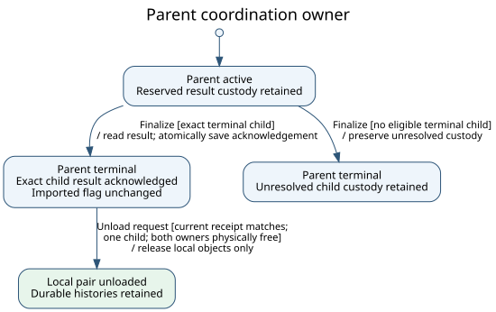
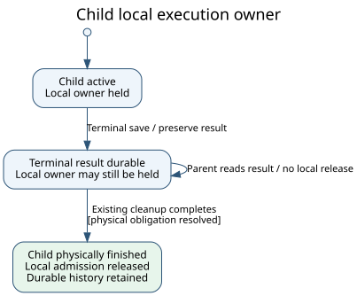
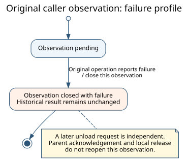

# Parent terminal acknowledgement model

The parent coordinating domain owns disposition of its reserved child results. A parent's final transaction can read an exact durable child result and acknowledge custody without claiming that a Tool callback imported that result into the parent business computation. Child-local recovery and caller observations keep their own lifetimes.

For example, a report parent fails because its reviewer child failed. The child result is already durable, but the parent never reaches its next Provider barrier. The parent can record a terminal acknowledgement in its own final transaction while leaving `imported: false`, both history holds intact, and the original failed observation closed. Later completed-pair unload still waits for both local owners to finish.

The baseline is applied G3e `2d896e73c607d62440993474c0ad0903523e7a54`. Contract concept v55 and foundation v48 remain the architecture references. This is a finite model of the new native-domain acknowledgement rule, not a refinement proof of Ruby, a replacement for the existing child-recovery models, or a new parent persistence-recovery protocol.

## Distinguish acknowledgement, import and local release

The parent's new observation is a guarded read during its actual terminal commit. Successful business import, terminal result acknowledgement, and local object release are three different facts. The imported flag retains its existing meaning; the acknowledgement records a separate disposition.

For example, a parent may finish for an unrelated error after its child has already completed. Reading and acknowledging that exact completed result is intentional custody adoption. It does not assert that the earlier child callback reached the parent or that the child's output influenced the parent's answer. An active sibling is not acknowledged by the same transaction.







The diagrams are separate UML-style views. Arrow labels show events, guards and actions; the child's physical completion can occur before or after the parent transaction. The client view deliberately selects an original observation that closes with failure. A later management call is a different observation and never reopens it.

| Model element | Implementation meaning |
| --- | --- |
| `child.status` | Authoritative child execution state; model `succeeded` maps to Ruby `completed`. |
| `child.slot` and `child.reservation` | Parent slot identity and the child's exact opaque reservation correlation. |
| `Receipt` | Versioned parent acknowledgement binding slot, child identity, reservation, status and stable result digest. |
| `child.content` | Abstract digest of materialized result, raw output, error and transfer receipt; actual hashing and JSON encoding require Ruby tests. |
| `parent.imported` | Existing business-import progress, unchanged by acknowledgement. |
| `parent.ack` | Separate terminal custody acknowledgement in the parent extension. |
| `CommitParent` | Guarded exact child observations and parent outcome/extension write in one outer transaction. |
| `attempt.known` | Existing synchronous parent commit/readback classification; no explicit later parent retry is modeled. |
| `child.ownerHeld` and `parent.ownerHeld` | Independent live execution ownership, including physical cleanup obligations. |
| `child.holds` and `parent.hold` | Durable history retention, unchanged by acknowledgement or local unload. |

The finite scenario has one selected child and an optional second reserved slot. `Sibling = "absent"` means there is no second slot, not that a second reserved execution is missing. A real second slot still prevents the existing single-child pair-unload operation even if its execution is absent. The primary child's nonterminal state can become terminal later; that later event does not retroactively add an acknowledgement to an already committed parent.

## Bind a durable receipt to the exact result

A historical acknowledgement proves what the parent adopted at its commit boundary. Local release additionally checks that the current exact child relationship and stable terminal result still match that receipt. History-ledger changes and later cancellation requests do not rewrite the terminal result.

For example, a changed child result digest or reservation after the acknowledgement prevents completed-pair unload. A later cancellation ledger entry or legitimate hold-generation change does not invalidate the stable result receipt. Both history holds remain present in the selected local-release scenario; arbitrary history deletion is outside it.

`Eligible` permits acknowledgement only for an actual finishing parent and a terminal child whose slot and reservation match. The atomic write preserves the parent's already computed outcome. `CurrentDisposition` accepts existing import or a matching acknowledgement; local release also retains the original exact relationship, single-child, holds and physical-owner checks.

The model does not encode a new callback receipt. Wrapper cancellation, preflight refusal and an unrelated parent error therefore cannot be misreported as successful child-result callback delivery. The parent transaction's explicit read is the acknowledgement event. Terminal siblings may be adopted by that read; active and suspended siblings remain unacknowledged. The model's `Finishing = FALSE` represents a nonterminal or pending parent commit, for which acknowledgement is forbidden.

The result-digest abstraction assumes collision resistance and faithful deterministic encoding with recursively ordered hash keys. Actual native JSON values, including signed zero and large integers, remain implementation-test obligations; the model does not equate this encoding with the restricted `CanonicalJSON` API. One integer distinguishes original and changed content; it does not model arbitrary Ruby values or prove cryptographic properties. Slot and reservation integers stand for complete identity checks, not shortened implementation receipts.

## Keep save knowledge and progress premises explicit

Atomic persistence and knowledge of its outcome are separate. A lost reply can leave a saved parent acknowledgement while the original observer has no successful result. Local release requires a fresh authoritative domain read, available local cleanup, and a caller that requests unload. Knowledge supplied by the original save response is not a prerequisite for that independent release proof.

For example, a lost commit reply followed by a successful existing readback can establish the saved parent outcome without rerunning the child or Provider. If that immediate readback is unavailable, the original observation can fail while existing physical cleanup releases the local parent owner. A later unload call can independently read and validate the durable terminal relationship and acknowledgement. If the later read is also unavailable, unload remains blocked. This does not invent a new public recovery API for participant commits.

The `Save` constant selects a committed post-state or rollback. `Reply` and `Readable` select direct knowledge or existing immediate readback. `UnloadReadable` separately controls the fresh guarded read performed by `UnloadPair`; that action does not reuse the original attempt's `known` field. The complete parent footprint contains its extension and acknowledgement. It need not freeze later child hold generations to prove a past parent commit. A deliberate mutation imposing that extra condition produces a progress counterexample.

The model begins after parent business policy has selected a terminal outcome. `ParentOutcome` is preserved, not recomputed from the child status: a cancelled child can still produce a failed parent under the existing native policy. Ruby acceptance separately covers `:raise` and `:skip` selection. The original caller is intentionally the failure-observation profile, including a failed observation of a durable parent post-state; the model does not claim that every successful or failed business execution produces this observation shape.

Weak fairness applies only to enabled parent commit/readback, observation closure, physical cleanup and explicit unload actions. No fairness assumption forces an unready child's terminal result to arrive before parent finalization. Without that ordering, a retained unacknowledged result is an expected progress counterexample, not permission to manufacture an acknowledgement afterward.

## Check safety, witnesses and deliberately broken rules

The case matrix checks the selected relationship and ownership rules independently from happy-path progress. Expected counterexamples distinguish a reachable valid state from an intentionally unsafe mutation or a missing progress premise.

For example, the pending-child-owner witness reaches a parent acknowledgement while the child's local owner is still held. The physical-release mutation then proves why that acknowledgement alone must not allow unload. A separate witness reaches a failed original observation followed by successful local release without changing the observation.

| Case family | Count | Expected result |
| --- | ---: | --- |
| Safety configurations | 17 | All selected invariants hold. |
| Progress configurations | 6 | Explicitly conditioned pair-release property holds. |
| Safety mutations | 13 | The named invariant has a counterexample. |
| Progress mutation | 1 | Freezing the child hold generation blocks parent proof. |
| Reachability witnesses | 7 | The negated witness invariant has a counterexample. |
| Missing-premise configurations | 5 | The selected progress property has a counterexample. |

The safety rules cover exact terminal acknowledgement, atomic parent acknowledgement, unchanged import meaning, durable history retention, no business replay, valid physical release, closed observations, and unchanged parent/child terminal outcomes. Mutations omit individual identity or digest checks, acknowledge active/waiting work, split acknowledgement from parent commit, rewrite imported state or parent outcome, drop holds, replay business work, release before physical completion, or reopen the failed observation.

Each configuration is stored verbatim in `cases.json`; the runner materializes it beside the copied model in the external output directory. Every expected negative result must match its named invariant or temporal-error class. Parser errors, runtime errors, wrong invariants and unexpected successful negative cases fail the runner.

## Reproduce the bounded verification

The runner pins the model-checking tool and records the exact model, configuration, command and output hashes. Generated TLC state files and logs stay outside the repository model directory.

For example, these commands run the full finite case matrix and regenerate the three diagrams with the same source inputs:

```sh
python3 spec/models/parent_child_result_import/run_checks.py \
  --jar /absolute/path/to/tla2tools-1.7.4.jar \
  --output /absolute/path/outside-the-model-source

dot -Tsvg spec/models/parent_child_result_import/parent-owner.dot \
  -o spec/models/parent_child_result_import/parent-owner.svg
dot -Tsvg spec/models/parent_child_result_import/child-owner.dot \
  -o spec/models/parent_child_result_import/child-owner.svg
dot -Tsvg spec/models/parent_child_result_import/client-observer.dot \
  -o spec/models/parent_child_result_import/client-observer.svg
```

The required TLC JAR SHA-256 is `936a262061c914694dfd669a543be24573c45d5aa0ff20a8b96b23d01e050e88`. Actual Ruby error reconstruction, receipt encoding, corrupt-record handling, Store adapters, revision guards, atomic backend conformance, native policy selection and existing owner cleanup require the accompanying implementation tests. Replay or explicit retry of an unresolved parent participant save, process loss, generic Handoff, multiple-child release and arbitrary administrative history disposition remain outside this bounded model.
